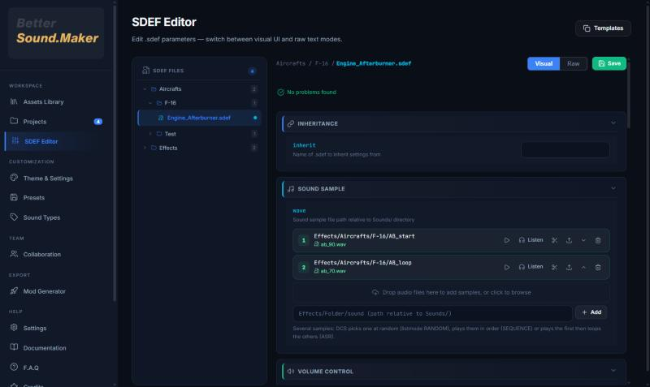

  

  # Better Sound.Maker

  
  
  
  

  

## English

A sound-mod maker for DCS World. Pick the game sounds you want to replace, drop in your audio,
tune each sound's SDEF (volume, distance, cone, loop) with a live checker, listen to it as it
will sound in game, and build a mod folder ready for `Mods\resource`, OVGME or Better Mods
Manager. Templates built from DCS's own files, an audio editor, A/B comparison, GitHub
collaboration and a community preset catalog.

**[Read the README in English](README_EN.md)** · [What's new in 1.1.0](Update/.md/PATCH_NOTES_v1.1.0.md)

## Français

Un créateur de mods son pour DCS World. Choisissez les sons du jeu à remplacer, déposez votre
audio, réglez le SDEF de chaque son (volume, distance, cône, boucle) avec un vérificateur en
direct, écoutez-le comme en jeu, puis construisez un dossier de mod prêt pour `Mods\resource`,
OVGME ou Better Mods Manager. Templates issus des fichiers de DCS, éditeur audio, comparaison
A/B, collaboration GitHub et catalogue de presets communautaire.

**[Lire le README en français](README_FR.md)** · [Nouveautés de la 1.1.0](Update/.md/PATCH_NOTES_v1.1.0.md)

---

  [Download / Télécharger](https://github.com/FreeProject089/Better-Sound.Maker/releases/latest) •
  [Documentation](https://freeproject089.github.io/Better-Sound.Maker/) •
  [Discord](https://discord.gg/CTaaEF9R75) •
  [Ko-fi](https://ko-fi.com/I2I31ZIPPG)

  Apache-2.0 · [LICENSE](LICENSE) · [Changelog](CHANGELOG.md)

