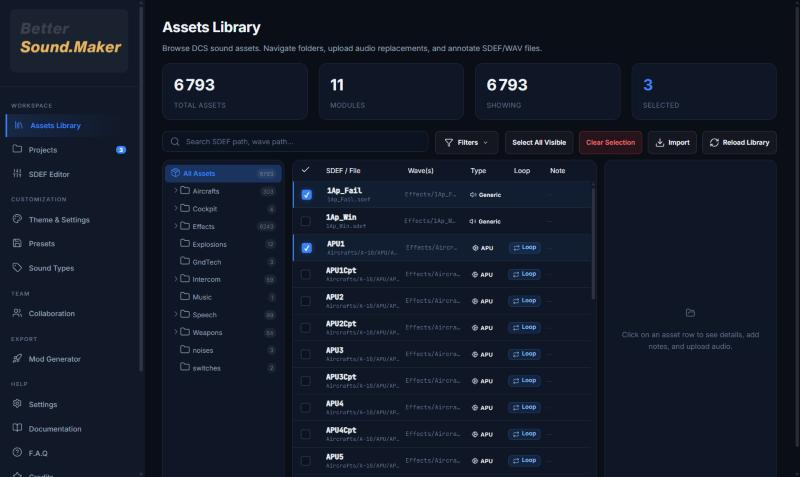
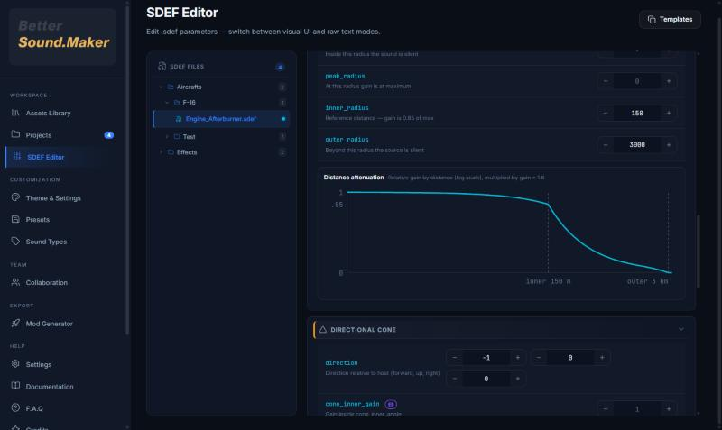
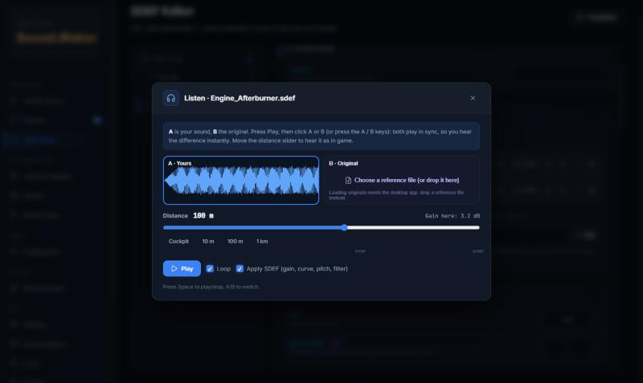
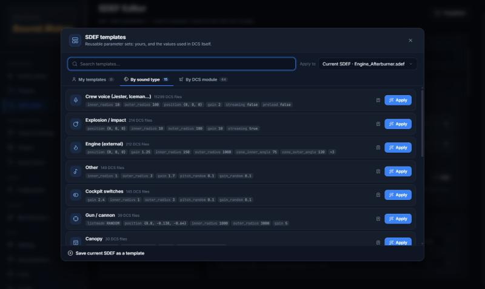
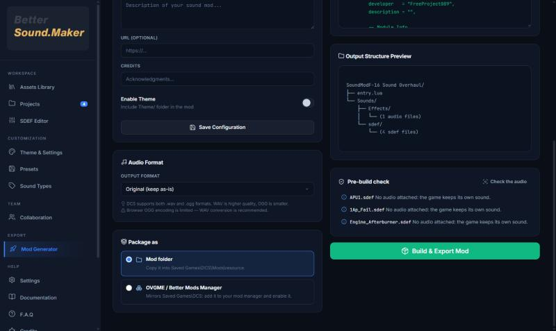
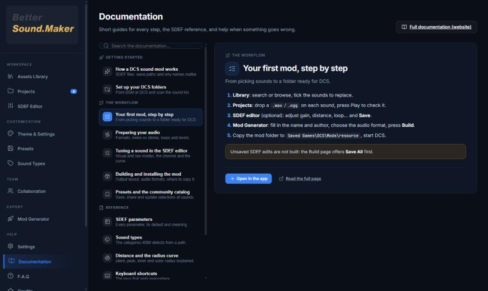

<div align="center">

  

  # Better Sound.Maker

  **Créez des mods son pour DCS World : choisissez les sons, déposez votre audio, réglez, écoutez, construisez.**

  
  
  
  
  

  [Télécharger](https://github.com/FreeProject089/Better-Sound.Maker/releases/latest) •
  [Documentation](https://freeproject089.github.io/Better-Sound.Maker/fr/) •
  [Discord](https://discord.gg/CTaaEF9R75) •
  [Ko-fi](https://ko-fi.com/I2I31ZIPPG) •
  [English](README_EN.md)

</div>

---

## Qu'est-ce que c'est

DCS ne joue jamais un fichier audio directement : il joue une **définition de son** (`.sdef`) qui
indique quel audio utiliser et comment — volume, hauteur, distance, cône, boucle. Un mod son
contient des SDEF aux **mêmes noms** que ceux du jeu, plus votre audio, et DCS utilise les vôtres.

Better Sound.Maker (BSM) fabrique tout ça pour vous. La **Bibliothèque** liste tous les sons de
DCS ; vous cochez ceux à remplacer, déposez vos `.wav` / `.ogg` dans **Projets**, les réglez dans
l'**éditeur SDEF** et appuyez sur **Construire**. Votre installation DCS n'est jamais modifiée :
le mod va dans `Saved Games\DCS\Mods\resource`, et supprimer ce dossier annule tout.

## Captures d'écran

| | |
|---|---|
|  **Bibliothèque** : tous les sons de DCS, arborescence, recherche, types de sons, étiquettes boucle / unique. |  **Éditeur SDEF** : échantillons à déposer, écouter, modifier et réordonner ; vérificateur en direct au-dessus. |
|  **Courbe de distance** : le volume du son selon la distance, d'après la formule de DCS. |  **Écoute & A/B** : entendez-le à 10 m, 100 m ou 1 km ; basculez avec l'original, synchronisés. |
|  **Templates** : les valeurs utilisées par Eagle Dynamics et les créateurs de modules, par type ou par module. |  **Générateur de mod** : vérification avant construction, format audio, dossier / OVGME / installation directe. |

<p align="center"><br/><sub>Le centre d'aide intégré : guides courts, référence SDEF et dépannage, en anglais et en français.</sub></p>

## Fonctionnalités

- **Bibliothèque** : tous les sons listés dans `sdef_and_wave_list.txt` de DCS, vos CoreMods et mods installés ; arborescence, recherche, filtres, détection du type de son.
- **Éditeur SDEF** : modes visuel et texte synchronisés ; tous les paramètres documentés et ceux trouvés dans les fichiers d'ED (`gain_random`, `pitch_random`, `cone_inner_gain`, `preload`, `looping`).
- **Vérificateur en direct** : fautes de frappe avec suggestions, ordre des rayons, conflits de cône et de lecture — cliquez sur un problème pour aller au champ.
- **Templates issus de DCS** : 15 par type de son et 44 par module, construits à partir des 17 000+ SDEF de modules d'une installation DCS ; à appliquer à un son, un dossier d'appareil ou tout le projet.
- **Mini-éditeur audio** : découpe, fondus, gain, normalisation, mono, et un fondu de boucle qui supprime le clic.
- **Écoute & A/B** : simulation de distance avec la courbe de gain, la hauteur et le filtre du SDEF ; A/B instantané avec l'original pour chaque son de module lisible dans votre DCS.
- **Construction** : vérification avant construction (audio manquant, erreurs SDEF, stéréo en 3D, saturation, clics de boucle) ; WAV, original ou vrai Ogg Vorbis ; dossier simple, paquet **OVGME / Better Mods Manager**, ou installation directe.
- **Presets & catalogue communautaire** : enregistrer des sélections, les partager, en installer, être prévenu des mises à jour.
- **Collaboration GitHub** : un commit par envoi, le dépôt est lui-même un mod fonctionnel, historique avec restauration, notes d'équipe.
- **Confort** : annuler / rétablir (Ctrl+Z / Ctrl+Y), palette de commandes (Ctrl+K), visite guidée de Tasky, crash logs (Ctrl+Maj+L), anglais et français.

## Nouveautés de la 1.1.0

La liste complète est dans les [notes de version 1.1.0](Update/.md/PATCH_NOTES_v1.1.0.md) et le [changelog](CHANGELOG.md). L'essentiel :

- **Nouveau moteur** : Tauri v2 à la place d'Electron — installeur environ dix fois plus léger, démarrage plus rapide.
- **Écoute comme en jeu** et **comparaison A/B** avec le son d'origine.
- **Mini-éditeur audio** et **templates SDEF générés depuis DCS** (par type et par module).
- **Prêt pour OVGME / Better Mods Manager**, ou installation directe dans `Mods\resource`.
- **Vérificateur SDEF en direct**, courbe de distance, vérification avant construction, vrai export OGG, annuler / rétablir, palette de commandes, crash logs.
- **Nouveau look** dans le style de Better Mods Manager, nouvel écran de démarrage et nouvelle visite, documentation refaite.
- **Corrigé** : les SDEF enregistrés depuis l'éditeur visuel activaient l'effet Doppler ; plusieurs bugs de lecture et d'échappement ; récupération GitHub sans l'audio.

## Installation

1. Téléchargez **`Better.Sound.Maker.Setup.1.1.0.exe`** depuis la [dernière version](https://github.com/FreeProject089/Better-Sound.Maker/releases/latest).
2. Lancez-le. Windows peut afficher SmartScreen la première fois : **Informations complémentaires → Exécuter quand même**.
3. Ouvrez Better Sound.Maker et indiquez votre dossier DCS (il le trouve tout seul sur la plupart des PC).

Prérequis : Windows 10 ou 11 avec WebView2 (présent sur Windows 11 et Windows 10 à jour).
L'installeur est fait avec [BetterInstaller](https://github.com/FreeProject089/BetterInstaller) :
il vérifie la signature Ed25519 du paquet avant d'écrire quoi que ce soit, installe par
utilisateur et gère les mises à jour avec retour arrière. Les installeurs NSIS
(`…_x64-nsis-setup.exe`) et MSI (`…_x64.msi`) sont sur la même page si vous les préférez.

**Mise à jour**

| Vous avez | Que faire |
|---|---|
| 1.1.0 ou plus | Acceptez la mise à jour proposée par BSM ; il s'installe et redémarre tout seul. |
| 1.0.x | Cette version ne peut pas se mettre à jour vers la 1.1.0 : téléchargez le nouvel installeur une fois et lancez-le. Vos projets, presets et paramètres sont conservés. |

## Documentation et aide

- **Documentation** : <https://freeproject089.github.io/Better-Sound.Maker/fr/> (guide, fonctionnement, référence SDEF, en français et en anglais)
- **Dans l'application** : **Documentation** et **F.A.Q** dans la section Aide, et **Ctrl+K** pour tout chercher
- **Discord** : <https://discord.gg/CTaaEF9R75>
- **Signaler un bug** : [GitHub Issues](https://github.com/FreeProject089/Better-Sound.Maker/issues) — joignez un crash log (**Ctrl+Maj+L** dans l'application)
- **Contribuer** : [Contribuer](CONTRIBUTING.md) · [Format du catalogue](docs/reference/catalog-format.fr.md)

## Compiler depuis les sources

Il faut Windows 10 ou 11, [Node.js](https://nodejs.org/) 22+, la chaîne
[Rust](https://www.rust-lang.org/tools/install) stable et les
[prérequis Tauri v2](https://v2.tauri.app/start/prerequisites/).

```bash
git clone https://github.com/FreeProject089/Better-Sound.Maker.git
cd Better-Sound.Maker
npm install
npm run tauri:dev          # l'application de bureau en mode développement
npm run dev                # la version web dans un navigateur (moins de fonctions)
npm run catalog:validate   # vérifier le catalogue et les types de sons fournis
```

Les builds de release (installeur BetterInstaller, NSIS, MSI, manifestes de mise à jour signés)
viennent de `scripts/release.ps1` ; voir la [checklist de release](docs/reference/release.fr.md).
Les templates SDEF se régénèrent depuis une installation DCS avec `npm run templates:build "<dossier DCS>"`.

## Licence

Better Sound.Maker est open source sous **licence Apache 2.0**. Voir [LICENSE](LICENSE).
DCS World est une marque d'Eagle Dynamics SA ; ce projet n'est pas affilié à Eagle Dynamics.
