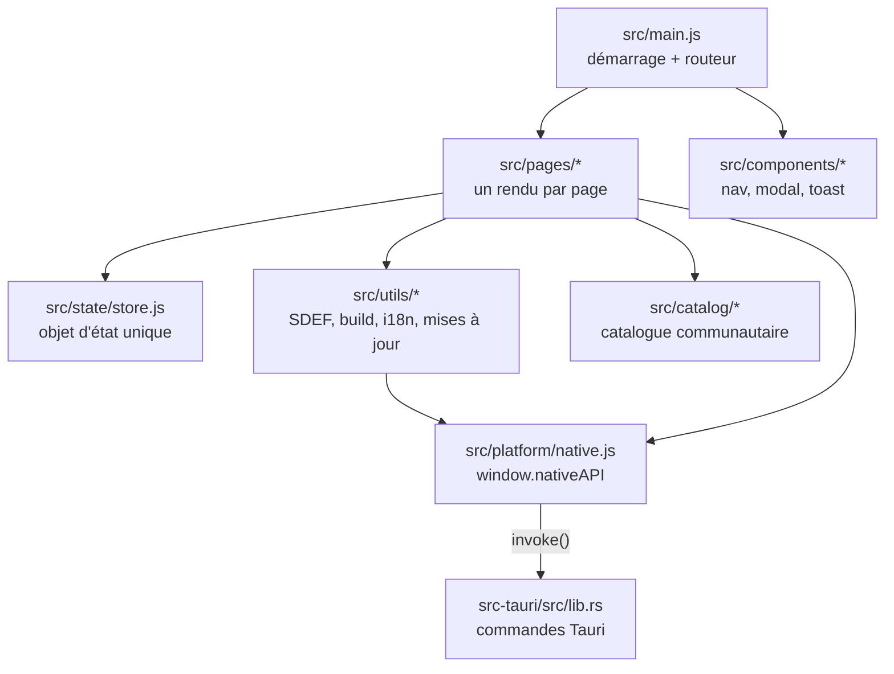
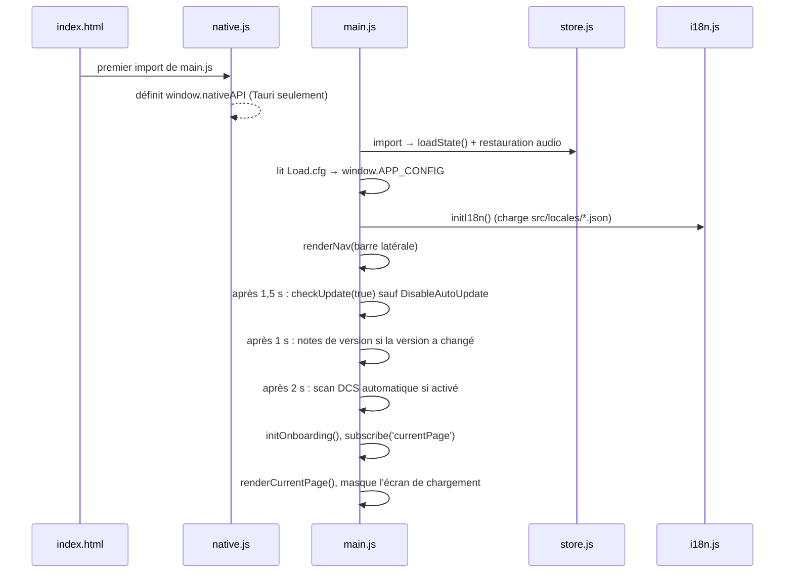

# Architecture

Better Sound.Maker est une application monopage écrite en JavaScript natif, empaquetée par Vite et
livrée dans une fenêtre Tauri v2. Il n'y a pas de framework : chaque page est une fonction qui écrit du
HTML dans un conteneur et branche ses propres écouteurs d'événements.

---

## Couches

Les flèches ne vont que vers le bas. Les pages lisent et modifient le store, appellent des utilitaires
et n'atteignent le disque qu'à travers `window.nativeAPI`. Aucun module en dehors de
`src/platform/native.js` n'importe `@tauri-apps/api` directement, sauf le code de mise à jour qui
importe à la demande `@tauri-apps/plugin-updater` et `@tauri-apps/plugin-process`
(voir [Mises à jour et versions](updates-and-releases.md)).

## Carte du code

| Dossier / fichier | Rôle |
|---|---|
| `index.html`, `src/style.css` | Squelette (barre latérale, conteneur de page, écran de chargement) et tout le style |
| [`src/main.js`](https://github.com/FreeProject089/Better-Sound.Maker/blob/main/src/main.js) | Démarrage, lecture de `Load.cfg`, routeur, notes de version, panneau de debug |
| [`src/Load.cfg`](https://github.com/FreeProject089/Better-Sound.Maker/blob/main/src/Load.cfg) | Interrupteurs fixés à la compilation (voir [Load.cfg](../reference/load-cfg.md)) |
| `src/pages/` | Un rendu par page : `library`, `project`, `sdef-editor`, `theme`, `presets`, `collaboration`, `custom-types`, `build`, `settings`, `docs`, `faq`, `credits`, plus `onboarding` |
| `src/components/` | Interface partagée : `nav.js` (barre latérale), `modal.js`, `toast.js` |
| [`src/state/store.js`](https://github.com/FreeProject089/Better-Sound.Maker/blob/main/src/state/store.js) | L'objet d'état unique, les abonnements, la persistance (voir [État et stockage](state-and-storage.md)) |
| `src/utils/` | Logique sans interface : `sdef-generator.js`, `sdef-lint.js`, `mod-builder.js`, `entry-generator.js`, `audio-analyzer.js`, `update-check.js`, `i18n.js`, `html.js`, `mod-loader.js`, `github-api.js`, `version.js` |
| `src/data/sdef-parser.js` | Lit le `sdef_and_wave_list.txt` de DCS et le découpe en sections de bibliothèque |
| `src/catalog/` | Chargeur (`catalog.js`) et validateur (`schema.js`) du catalogue communautaire |
| [`src/platform/native.js`](https://github.com/FreeProject089/Better-Sound.Maker/blob/main/src/platform/native.js) | Le pont natif : définit `window.nativeAPI` |
| `src/locales/` | Traductions de l'interface `en.json`, `fr.json` |
| `public/` | Fichiers statiques servis tels quels : `catalog.json` embarqué, `sound-types/`, `presets/`, un `sdef_and_wave_list.txt` de secours, images |
| [`src-tauri/`](https://github.com/FreeProject089/Better-Sound.Maker/tree/main/src-tauri) | Backend Rust (`src/lib.rs`), `tauri.conf.json`, `capabilities/`, icônes |
| `installer/installer.toml` | Configuration BetterInstaller |
| `scripts/` | `release.ps1` (fichiers de version), `catalog.mjs` (validation/génération du catalogue) |
| `schemas/` | Schémas JSON des fichiers du catalogue |
| `Update/` | Notes de version livrées avec l'application (`Update/.md/PATCH_NOTES_v<version>.md`) |

## Séquence de démarrage {#boot-sequence}

**Pourquoi l'import du pont doit venir en premier.** `src/main.js` commence par
`import './platform/native.js'`. Les modules ES sont évalués dans l'ordre des imports, et certains
lisent `window.nativeAPI` *au moment de l'import*, pas à l'appel d'une fonction. Par exemple
`src/utils/mod-builder.js` calcule `const isNative = typeof window.nativeAPI !== 'undefined'` au
niveau du module, et `store.js` commence à restaurer l'audio depuis le disque dès qu'il est importé.
Si le pont était défini plus tard, ces modules se croiraient définitivement dans un navigateur.

**Lecture de Load.cfg.** Le fichier est importé comme texte brut (`import rawCfg from './Load.cfg?raw'`) :
il est donc intégré au bundle à la compilation, et le modifier dans une copie installée n'a aucun effet.
Chaque ligne contenant `=` est coupée au premier `=`, les deux côtés sont nettoyés, et le résultat va
dans `window.APP_CONFIG`. Les valeurs restent des **chaînes**, d'où les comparaisons `=== 'true'`.

## Routage

Il n'y a pas de routeur d'URL. La page courante est une clé du store (`currentPage`, `library` par
défaut). `navigate(page)` dans `store.js` la modifie ; `main.js` est abonné à `currentPage` et appelle
`renderCurrentPage()`, qui vide `#page-container` et appelle le rendu correspondant dans la table
`pages`. Comme `currentPage` est sauvegardé, l'application rouvre sur la dernière page utilisée.

## Traductions (i18n)

[`src/utils/i18n.js`](https://github.com/FreeProject089/Better-Sound.Maker/blob/main/src/utils/i18n.js)
charge tous les `src/locales/*.json` via `import.meta.glob` : ajouter une langue, c'est ajouter un fichier.

- La langue courante est stockée dans `localStorage` sous `dcs-sound-mod-creator::language` (`en` par défaut).
- `t(clé, params)` cherche une clé pointée ; si elle manque, elle se rabat sur le fichier anglais.
- Changer de langue émet l'événement `languageChanged` ; `main.js` redessine la page et la barre latérale.
- Beaucoup d'appels portent aussi un texte anglais de secours (`t('x') || 'Text'`), si bien qu'une clé manquante n'affiche jamais de vide.

!!! note "Deux langues, deux systèmes"
    Les traductions de l'interface dans `src/locales` sont indépendantes de ce site de documentation,
    qui utilise MkDocs avec des fichiers `page.md` / `page.fr.md`.
