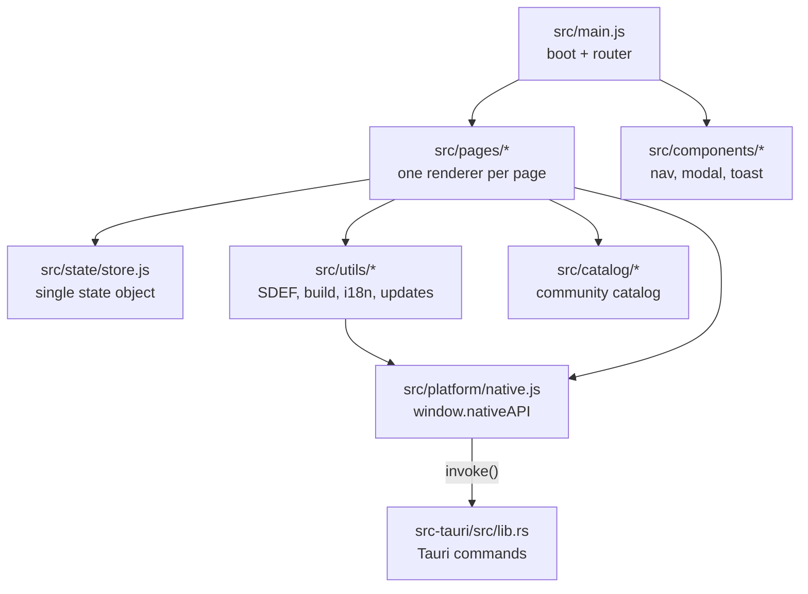
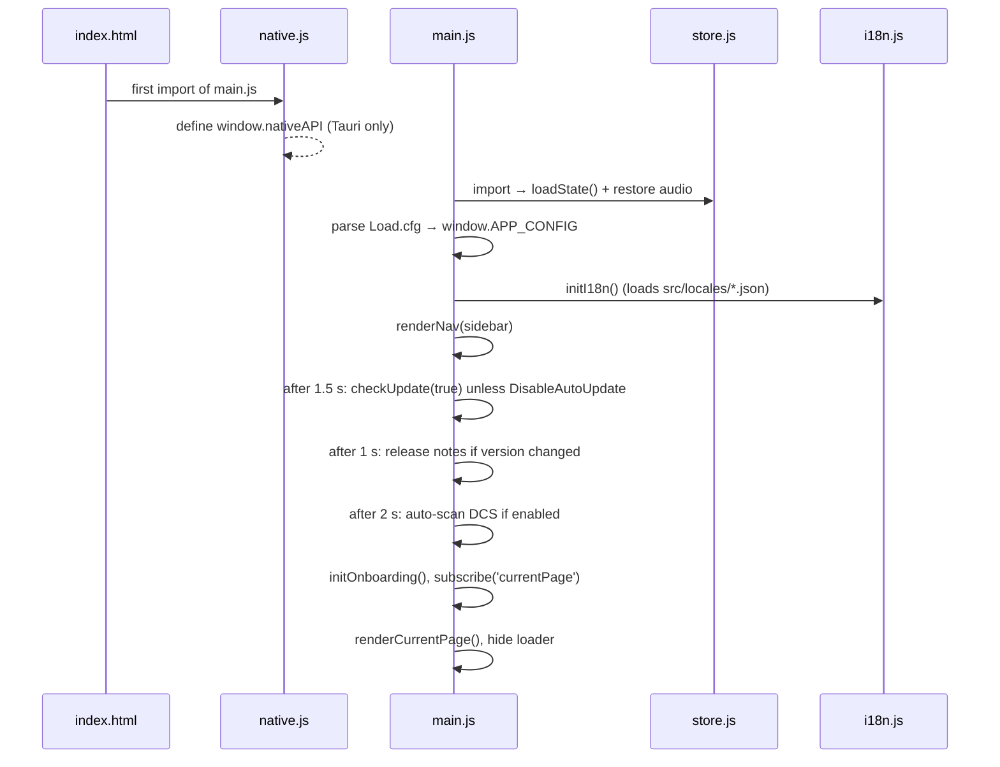

# Architecture

Better Sound.Maker is a single-page app written in vanilla JavaScript, bundled by Vite, and shipped
inside a Tauri v2 window. There is no framework: each page is a function that writes HTML into a
container and wires its own event listeners.

---

## Layers

The arrows only go down. Pages read and write the store, call utilities, and reach the disk only
through `window.nativeAPI`. Nothing outside `src/platform/native.js` imports `@tauri-apps/api`
directly, except the updater code, which imports `@tauri-apps/plugin-updater` and
`@tauri-apps/plugin-process` lazily (see [Updates and releases](updates-and-releases.md)).

## Codebase map

| Folder / file | Responsibility |
|---|---|
| `index.html`, `src/style.css` | Shell markup (sidebar, page container, loader) and all styling |
| [`src/main.js`](https://github.com/FreeProject089/Better-Sound.Maker/blob/main/src/main.js) | Boot sequence, `Load.cfg` parsing, page router, release notes, dev panel |
| [`src/Load.cfg`](https://github.com/FreeProject089/Better-Sound.Maker/blob/main/src/Load.cfg) | Build-time feature switches (see [Load.cfg reference](../reference/load-cfg.md)) |
| `src/pages/` | One renderer per page: `library`, `project`, `sdef-editor`, `theme`, `presets`, `collaboration`, `custom-types`, `build`, `settings`, `docs`, `faq`, `credits`, plus `onboarding` |
| `src/components/` | Shared UI: `nav.js` (sidebar), `modal.js`, `toast.js` |
| [`src/state/store.js`](https://github.com/FreeProject089/Better-Sound.Maker/blob/main/src/state/store.js) | The single state object, subscriptions, persistence (see [State and storage](state-and-storage.md)) |
| `src/utils/` | Logic with no UI: `sdef-generator.js`, `sdef-lint.js`, `mod-builder.js`, `entry-generator.js`, `audio-analyzer.js`, `update-check.js`, `i18n.js`, `html.js`, `mod-loader.js`, `github-api.js`, `version.js` |
| `src/data/sdef-parser.js` | Parses DCS's `sdef_and_wave_list.txt` into library sections |
| `src/catalog/` | Community catalog loader (`catalog.js`) and validator (`schema.js`) |
| [`src/platform/native.js`](https://github.com/FreeProject089/Better-Sound.Maker/blob/main/src/platform/native.js) | The desktop bridge: defines `window.nativeAPI` |
| `src/locales/` | `en.json`, `fr.json` UI translations |
| `public/` | Static files served as-is: bundled `catalog.json`, `sound-types/`, `presets/`, a fallback `sdef_and_wave_list.txt`, images |
| [`src-tauri/`](https://github.com/FreeProject089/Better-Sound.Maker/tree/main/src-tauri) | Rust backend (`src/lib.rs`), `tauri.conf.json`, `capabilities/`, icons |
| `installer/installer.toml` | BetterInstaller configuration |
| `scripts/` | `release.ps1` (release assets), `catalog.mjs` (catalog validate/build) |
| `schemas/` | JSON Schemas for catalog files |
| `Update/` | Patch notes shipped with the app (`Update/.md/PATCH_NOTES_v<version>.md`) |

## Boot sequence

**Why the bridge import must come first.** `src/main.js` starts with `import './platform/native.js'`.
ES modules are evaluated in import order, and some modules read `window.nativeAPI` *at import time*,
not when a function is called. For example `src/utils/mod-builder.js` computes
`const isNative = typeof window.nativeAPI !== 'undefined'` at the top level, and `store.js` starts
restoring audio from disk as soon as it is imported. If the bridge were defined later, those modules
would permanently believe they run in a browser.

**Load.cfg parsing.** The file is imported as raw text (`import rawCfg from './Load.cfg?raw'`), so
it is baked into the bundle at build time: editing it in an installed copy has no effect. Each
line containing `=` is split at the first `=`, both sides trimmed, and stored in
`window.APP_CONFIG`. Values stay **strings**, which is why code compares `=== 'true'`.

## Routing

There is no URL router. The current page is a key in the store (`currentPage`, default `library`).
`navigate(page)` in `store.js` sets it; `main.js` subscribes to `currentPage` and calls
`renderCurrentPage()`, which empties `#page-container` and calls the matching renderer from the
`pages` map. Because `currentPage` is persisted, the app reopens on the last page you used.

## Translations (i18n)

[`src/utils/i18n.js`](https://github.com/FreeProject089/Better-Sound.Maker/blob/main/src/utils/i18n.js)
loads every `src/locales/*.json` through `import.meta.glob`, so adding a language is adding a file.

- The current language is stored in `localStorage` under `dcs-sound-mod-creator::language` (default `en`).
- `t(key, params)` looks up a dotted key; when missing, it falls back to the English file.
- Changing language dispatches a `languageChanged` window event; `main.js` re-renders the page and the sidebar.
- Many call sites also carry an inline English fallback (`t('x') || 'Text'`), so a missing key never shows blank.

!!! note "Two languages, two systems"
    The UI translations in `src/locales` are separate from this documentation site, which uses
    MkDocs with `page.md` / `page.fr.md` files.
