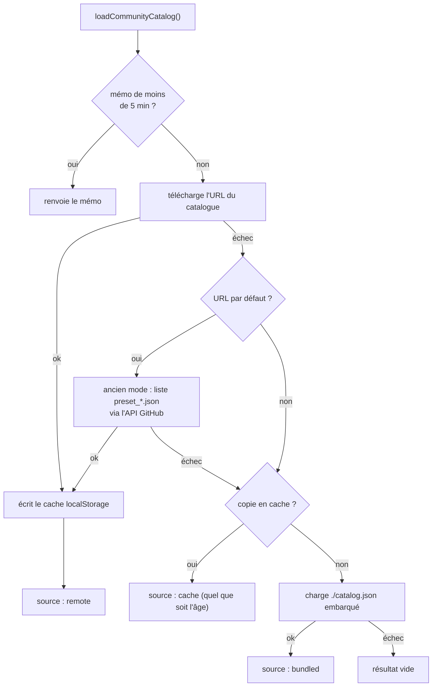

# Chargement du catalogue

Les presets et packs de types de sons communautaires viennent d'un unique `catalog.json` accessible
par URL. Cette page explique comment l'application le trouve, le valide et se rabat sur autre chose
quand le réseau est coupé. Le format lui-même est décrit dans [Format du catalogue](../reference/catalog-format.md).

Code : [`src/catalog/catalog.js`](https://github.com/FreeProject089/Better-Sound.Maker/blob/main/src/catalog/catalog.js)
(chargeur) et [`src/catalog/schema.js`](https://github.com/FreeProject089/Better-Sound.Maker/blob/main/src/catalog/schema.js) (validation).

---

## Quelle URL

`getCatalogUrl()` renvoie la première valeur non vide parmi :

1. l'URL enregistrée dans *Paramètres → Catalogue communautaire* (`globalSettings.catalogUrl`) ;
2. `CommunityCatalogUrl` dans [`Load.cfg`](../reference/load-cfg.md) ;
3. l'URL par défaut `https://raw.githubusercontent.com/BetterDCS/Better-Sound.Maker-Community-Presets/main/catalog.json`.

`DisableCommunityPresets = true` dans `Load.cfg` court-circuite tout : le chargeur renvoie un
résultat vide avec `source: 'disabled'`.

## Ordre de résolution



| Étape | Pourquoi |
|---|---|
| Mémo en mémoire, 5 minutes | plusieurs pages demandent le catalogue ; un seul chargement réseau les sert toutes. Les appels simultanés partagent la même promesse en cours |
| Distant | contenu frais ; requêtes en `cache: 'no-store'` avec un paramètre `?t=` anti-cache et un délai maximal de 10 s |
| Liste GitHub (ancien mode) | le dépôt communautaire est antérieur à `catalog.json` ; tant qu'il n'en a pas, ses fichiers `preset_*.json` sont listés via `api.github.com`. Tenté uniquement pour l'URL par défaut |
| Cache hors ligne | le dernier résultat distant réussi dans `localStorage` (`bsm-community-catalog-cache`), quel que soit son âge |
| Embarqué | `public/catalog.json`, livré avec l'application : un premier lancement hors ligne a quand même du contenu |

Chaque erreur rencontrée est collectée dans `result.errors` et journalisée avec `[Catalog]` ; le
résultat indique aussi sa `source`. *Paramètres → Tester* s'en sert pour afficher
`Catalog OK: N presets, M sound-type packs`.

## Validation {#validation}

Rien de ce qui vient du réseau n'est utilisé tel quel. `schema.js` fournit des fonctions `normalize*`
qui renvoient `{ value, errors }` : `value` est une copie nettoyée (ou `null` si inutilisable),
`errors` des messages.

- `normalizeCatalog` : `url` obligatoire pour chaque entrée, résolue par rapport à l'URL du catalogue, schéma limité à `http`, `https` ou `file` ; identifiants en double écartés ; un `schemaVersion` supérieur à 1 produit un avertissement, pas un échec.
- `normalizePreset` : `name` obligatoire, `assetPaths` doit être un tableau (chemins vides et doublons retirés), `color` invalide ou `version` non numérique remplacés par des valeurs par défaut.
- `normalizeSoundTypes` : identifiants de type en minuscules `a-z 0-9 _ -`, chaque type a besoin d'un `label`, chaque règle de `match` et `type`, l'expression régulière doit compiler et le type doit exister (dans ce pack ou un précédent).

Chaque preset et pack est chargé indépendamment : **un fichier cassé ne casse jamais le catalogue**,
il est écarté et signalé.

## Ordre de fusion des packs de types de sons

[`src/utils/audio-analyzer.js`](https://github.com/FreeProject089/Better-Sound.Maker/blob/main/src/utils/audio-analyzer.js)
construit la liste des types et des règles dans cet ordre :

1. les packs **embarqués** listés dans `public/sound-types/index.json` (`default.json` si l'index manque) ;
2. les packs **communautaires** du catalogue, dans l'ordre du catalogue ;
3. les **types personnalisés** de l'utilisateur depuis `localStorage` (`bsm-custom-types`) : les types sont fusionnés et les règles **ajoutées en tête** (`unshift`).

Comme la première règle qui correspond l'emporte, les règles de l'utilisateur passent avant tout, et
les règles embarquées sont essayées avant les communautaires. Un pack peut utiliser des types définis
par un pack précédent, c'est pourquoi chaque pack est validé avec les types déjà connus.

## `scripts/catalog.mjs`

Le même `schema.js` est réutilisé depuis Node, pour que l'application et l'outillage soient d'accord :

```bash
node scripts/catalog.mjs validate [catalog.json]   # par défaut public/catalog.json ; code 1 en cas d'erreur
node scripts/catalog.mjs build <dossier> [--out f] # scanne preset_*.json + sound-types/*.json, écrit catalog.json
```

`npm run catalog:validate` et `npm run catalog:build` sont des raccourcis. `validate` vérifie aussi
les packs embarqués de `public/sound-types`.
