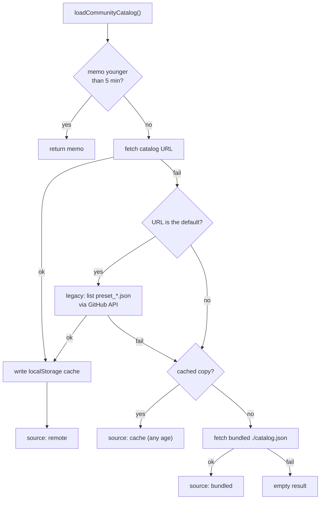

# Catalog loading

Community presets and sound-type packs come from one `catalog.json` reachable by URL. This page
explains how the app finds it, validates it and falls back when the network is down. The file
format itself is in [Catalog format](../reference/catalog-format.md).

Code: [`src/catalog/catalog.js`](https://github.com/FreeProject089/Better-Sound.Maker/blob/main/src/catalog/catalog.js)
(loader) and [`src/catalog/schema.js`](https://github.com/FreeProject089/Better-Sound.Maker/blob/main/src/catalog/schema.js) (validation).

---

## Which URL

`getCatalogUrl()` returns the first non-empty value of:

1. the URL saved in *Settings → Community catalog* (`globalSettings.catalogUrl`);
2. `CommunityCatalogUrl` in [`Load.cfg`](../reference/load-cfg.md);
3. the default `https://raw.githubusercontent.com/BetterDCS/Better-Sound.Maker-Community-Presets/main/catalog.json`.

`DisableCommunityPresets = true` in `Load.cfg` short-circuits everything: the loader returns an empty
result with `source: 'disabled'`.

## Resolution order



| Step | Why |
|---|---|
| In-memory memo, 5 minutes | many pages ask for the catalog; one network load serves them all. Concurrent callers share the same in-flight promise |
| Remote | fresh content; requests use `cache: 'no-store'` and a `?t=` cache-buster, with a 10 s timeout |
| Legacy GitHub listing | the community repo predates `catalog.json`; until it has one, its `preset_*.json` files are listed through `api.github.com`. Only tried for the default URL |
| Offline cache | the last successful remote result in `localStorage` (`bsm-community-catalog-cache`), whatever its age |
| Bundled | `public/catalog.json`, shipped with the app, so a first launch offline still has content |

Every error encountered on the way is collected in `result.errors` and logged with `[Catalog]`; the
result also says which `source` it came from. *Settings → Test* uses this to report
`Catalog OK: N presets, M sound-type packs`.

## Validation

Nothing from the network is trusted as-is. `schema.js` exposes `normalize*` functions that return
`{ value, errors }`: `value` is a cleaned copy (or `null` when unusable), `errors` are messages.

- `normalizeCatalog`: `url` required per entry, resolved relative to the catalog URL, scheme must be `http`, `https` or `file`; duplicate ids are dropped; a `schemaVersion` newer than 1 produces a warning, not a failure.
- `normalizePreset`: `name` required, `assetPaths` must be an array (empty and duplicate paths removed), invalid `color` or non-numeric `version` replaced by defaults.
- `normalizeSoundTypes`: type ids must match lowercase `a-z 0-9 _ -`, each type needs a `label`, each rule needs `match` and `type`, the regex must compile, and the type must exist (in this pack or an earlier one).

Each preset and pack is loaded independently: **one broken file never breaks the catalog**, it is
skipped and reported.

## Sound-type pack merge order

[`src/utils/audio-analyzer.js`](https://github.com/FreeProject089/Better-Sound.Maker/blob/main/src/utils/audio-analyzer.js)
builds the type list and the rule list in this order:

1. **bundled** packs listed in `public/sound-types/index.json` (`default.json` if the index is missing);
2. **community** packs from the catalog, in catalog order;
3. **user custom types** from `localStorage` (`bsm-custom-types`): types are merged, and rules are **prepended** (`unshift`).

Because the first matching rule wins, user rules take priority over everything, and bundled rules
are tried before community ones. A pack may reference types defined by an earlier pack, which is
why packs are validated with the types known so far.

## `scripts/catalog.mjs`

The same `schema.js` is reused from Node so the app and the tooling agree:

```bash
node scripts/catalog.mjs validate [catalog.json]   # default: public/catalog.json; exit 1 on error
node scripts/catalog.mjs build <dir> [--out file]  # scan preset_*.json + sound-types/*.json, write catalog.json
```

`npm run catalog:validate` and `npm run catalog:build` are shortcuts. `validate` also checks the
bundled `public/sound-types` packs.
