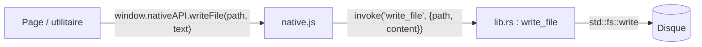

# Pont natif

Le frontend ne parle jamais directement à Tauri. Il appelle `window.nativeAPI`, un petit objet gelé
défini dans [`src/platform/native.js`](https://github.com/FreeProject089/Better-Sound.Maker/blob/main/src/platform/native.js).
Chaque méthode transmet l'appel à une commande Rust de
[`src-tauri/src/lib.rs`](https://github.com/FreeProject089/Better-Sound.Maker/blob/main/src-tauri/src/lib.rs).

Cette forme vient de la version Electron : l'ancien script preload exposait la même surface
`window.nativeAPI`, si bien que le passage à Tauri v2 n'a pas obligé à modifier les pages.



---

## Détection

`native.js` cherche `__TAURI_INTERNALS__` sur `window`. Ce n'est que dans la webview Tauri qu'il
construit l'API et fait `window.nativeAPI = Object.freeze(api)`. Dans un navigateur normal, la propriété
reste **undefined** et chaque appelant se protège avec `if (window.nativeAPI)`. C'est tout le repli web :
le même chemin de code choisit entre le comportement bureau et navigateur.

## Commandes

| Méthode JS | Commande Tauri | Arguments | Retour | En cas d'erreur |
|---|---|---|---|---|
| `selectDirectory()` / `pickFolder()` | `select_directory` | aucun | dossier choisi (barres obliques `/`) ou `null` si annulé | n'échoue jamais |
| `writeFile(path, content)` | `write_file` | `path`, `content` UTF-8 | `true` | rejet avec le message du système |
| `writeBuffer(path, arrayBuffer)` | `write_buffer` | corps brut + en-tête `x-path` | `true` | rejet (`missing x-path header`, `expected raw binary body`, erreur système) |
| `mkdir(path)` | `mkdir` | `path` | `true` | rejet avec l'erreur système |
| `readFile(path)` | `read_file` | `path` | `ArrayBuffer` | l'enveloppe JS intercepte et renvoie `null` |
| `readTextFile(path)` | `read_text_file` | `path` | chaîne (UTF-8 tolérant) | `null` si le fichier est illisible |
| `readDir(path)` | `read_dir` | `path` | tableau de noms d'entrées | tableau vide |
| `exists(path)` | `exists` | `path` | booléen | `false` |
| `scanSdefs(root)` | `scan_sdefs` | `root` | `[{ relPath, content, waves }]` pour chaque `*.sdef` sous `root` | tableau vide si `root` n'existe pas ; fichiers illisibles ignorés |
| `getAppPath()` | `get_app_path` | aucun | dossier des ressources (`Update/`, `LICENSE`, `public/presets` embarqués) | rejet |
| `getUserHome()` | `get_user_home` | aucun | dossier personnel | rejet |
| `openExternal(path)` | `open_path` | `path` | rien | rejet |
| `biCheckUpdate()` | `bi_check_update` | aucun | `null`, ou le rapport JSON de BetterInstaller | voir [Mises à jour](updates-and-releases.md) |
| `biApplyUpdate()` | `bi_apply_update` | aucun | l'application se ferme | rejet avec `not a BetterInstaller install` |
| `encodeOgg(planar, channels, rate, quality = 0.5)` | `encode_ogg` | corps brut : `f32` little-endian planaire, canal après canal ; en-têtes `x-channels` (1–2), `x-rate`, `x-quality` | octets Ogg Vorbis (`ArrayBuffer`) | rejet si un en-tête est invalide ou si la taille ne correspond pas au nombre de canaux |
| `openUrl(url)` | plugin `opener` | `url` | rien | selon le plugin |

Détails utiles :

- `write_file` et `write_buffer` appellent d'abord `create_dir_all` sur le dossier parent : écrire un chemin profond n'échoue jamais pour un dossier manquant.
- Les chemins renvoyés au JS utilisent des `/` (`replace('\\', "/")`), comme le reste du frontend.
- `scan_sdefs` parcourt l'arborescence avec `walkdir` et extrait chaque ligne commençant par `wave` et contenant une chaîne entre guillemets. Les `\` deviennent `/` et un `/` initial est retiré : `"\\Aircrafts\\F18\\eng.wav"` devient `Aircrafts/F18/eng.wav` (un test unitaire le vérifie).
- `read_file` renvoie une `Response` Tauri, qui arrive en JavaScript sous forme d'`ArrayBuffer` sans encodage JSON.

## Écriture binaire : corps brut et en-tête `x-path`

Un fichier audio peut peser des dizaines de mégaoctets. L'envoyer comme argument JSON transformerait
chaque octet en nombre dans un tableau JSON. `writeBuffer` appelle donc

```js
invoke('write_buffer', new Uint8Array(arrayBuffer), {
    headers: { 'x-path': encodeURIComponent(path) },
});
```

Le corps contient les octets bruts (`InvokeBody::Raw` côté Rust). Le chemin ne peut pas voyager dans le
corps : il passe dans l'en-tête `x-path`, encodé en URI car les en-têtes doivent être ASCII et les
chemins peuvent contenir des espaces ou des accents. `lib.rs` le décode avec sa propre fonction
`percent_decode` (testée avec `C%3A%2FSaved%20Games%2F%C3%A9.wav`).

## Les liens externes s'ouvrent dans le navigateur du système

Une webview Tauri ne peut pas ouvrir de nouvelles fenêtres. En mode bureau, `native.js` :

1. écoute chaque clic sur un `<a href>` ; si le lien est `http(s)` et vise une autre origine, il annule la navigation et l'ouvre avec le plugin `opener` ;
2. remplace `window.open(url)` par le même appel, qui renvoie `null`.

La fonction exportée `openUrl(url)` utilise `nativeAPI.openUrl` sur bureau et `window.open(url, '_blank')` sur le web.

## Capacités

[`src-tauri/capabilities/default.json`](https://github.com/FreeProject089/Better-Sound.Maker/blob/main/src-tauri/capabilities/default.json)
s'applique à la fenêtre `main` et accorde :

| Permission | Sert à |
|---|---|
| `core:default` | l'IPC de base de Tauri |
| `opener:allow-open-url` | ouvrir les liens dans le navigateur du système |
| `process:allow-restart` | `relaunch()` après une mise à jour Tauri |
| `updater:default` | `check()` / `downloadAndInstall()` |

Les commandes propres à l'application (`write_file`, `read_file`…) sont enregistrées via
`generate_handler!` et ne sont limitées par aucune portée de chemins. Voir
[Sécurité](security.md#file-system-scope) pour ce que cela implique.

## Dans le navigateur {#in-the-browser}

Quand `window.nativeAPI` est indéfini :

| Fonction | Comportement dans le navigateur |
|---|---|
| Bibliothèque | charge `public/sdef_and_wave_list.txt` au lieu de votre installation DCS ; pas de scan CoreMods / Saved Games |
| Persistance audio | fichiers stockés dans IndexedDB au lieu d'être relus sur le disque |
| Construction | sélecteur de dossier File System Access API si disponible, sinon téléchargement `.zip` (voir [Construction du mod](mod-build.md)) |
| Mises à jour | seulement la vérification de version `package.json` sur GitHub |
| Notes de version, fichier de licence | non lus sur le disque |
