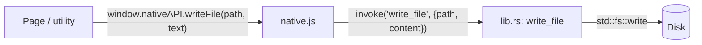

# Desktop bridge

The frontend never talks to Tauri directly. It calls `window.nativeAPI`, a small frozen object defined
in [`src/platform/native.js`](https://github.com/FreeProject089/Better-Sound.Maker/blob/main/src/platform/native.js).
Each method forwards to a Rust command in
[`src-tauri/src/lib.rs`](https://github.com/FreeProject089/Better-Sound.Maker/blob/main/src-tauri/src/lib.rs).

This shape is inherited from the Electron version: the old preload script exposed the same
`window.nativeAPI` surface, so when the shell moved to Tauri v2 the pages did not need to change.



---

## Detection

`native.js` checks for `__TAURI_INTERNALS__` on `window`. Only inside the Tauri webview does it build
the API and assign `window.nativeAPI = Object.freeze(api)`. In a normal browser the property stays
**undefined**, and every caller guards with `if (window.nativeAPI)`. That is the whole web fallback:
the same code path decides between the desktop and browser behaviour.

## Commands

| JS method | Tauri command | Arguments | Returns | On error |
|---|---|---|---|---|
| `selectDirectory()` / `pickFolder()` | `select_directory` | none | chosen folder path (forward slashes) or `null` if cancelled | never fails |
| `writeFile(path, content)` | `write_file` | `path`, UTF-8 `content` | `true` | rejects with the OS error message |
| `writeBuffer(path, arrayBuffer)` | `write_buffer` | raw body + `x-path` header | `true` | rejects (`missing x-path header`, `expected raw binary body`, OS error) |
| `mkdir(path)` | `mkdir` | `path` | `true` | rejects with the OS error |
| `readFile(path)` | `read_file` | `path` | `ArrayBuffer` | the JS wrapper catches and returns `null` |
| `readTextFile(path)` | `read_text_file` | `path` | string (lossy UTF-8) | `null` when the file cannot be read |
| `readDir(path)` | `read_dir` | `path` | array of entry names | empty array |
| `exists(path)` | `exists` | `path` | boolean | `false` |
| `scanSdefs(root)` | `scan_sdefs` | `root` | `[{ relPath, content, waves }]` for every `*.sdef` under `root` | empty array if `root` is missing; unreadable files skipped |
| `getAppPath()` | `get_app_path` | none | resource directory (bundled `Update/`, `LICENSE`, `public/presets`) | rejects |
| `getUserHome()` | `get_user_home` | none | home directory | rejects |
| `openExternal(path)` | `open_path` | `path` | nothing | rejects |
| `biCheckUpdate()` | `bi_check_update` | none | `null`, or the BetterInstaller JSON report | see [Updates](updates-and-releases.md) |
| `biApplyUpdate()` | `bi_apply_update` | none | the app exits | rejects with `not a BetterInstaller install` |
| `openUrl(url)` | plugin `opener` | `url` | nothing | from the plugin |

Details worth knowing:

- `write_file` and `write_buffer` call `create_dir_all` on the parent first, so writing a deep path never fails just because a folder is missing.
- Paths returned to JS use forward slashes (`replace('\\', "/")`), matching the rest of the frontend.
- `scan_sdefs` walks the tree with `walkdir` and extracts each line starting with `wave` that contains a quoted string. Backslashes become `/` and a leading `/` is removed, so `"\\Aircrafts\\F18\\eng.wav"` becomes `Aircrafts/F18/eng.wav` (there is a unit test for this).
- `read_file` returns a Tauri `Response`, which reaches JavaScript as an `ArrayBuffer` without JSON encoding.

## Binary writes: raw body and `x-path` header

Audio files can be tens of megabytes. Sending them as a JSON argument would turn every byte into a
number in a JSON array. Instead `writeBuffer` calls

```js
invoke('write_buffer', new Uint8Array(arrayBuffer), {
    headers: { 'x-path': encodeURIComponent(path) },
});
```

The body is the raw bytes (`InvokeBody::Raw` in Rust). The target path cannot travel in the body, so
it goes in the `x-path` header, URI-encoded because headers must be ASCII and paths can contain
spaces or accents. `lib.rs` decodes it with its own `percent_decode` (unit-tested with
`C%3A%2FSaved%20Games%2F%C3%A9.wav`).

## External links go to the system browser

A Tauri webview cannot open new windows. In desktop mode `native.js` therefore:

1. listens to every click on an `<a href>`; when the link is `http(s)` and points to another origin, it cancels the navigation and opens it with the `opener` plugin;
2. replaces `window.open(url)` with the same call, returning `null`.

The exported helper `openUrl(url)` uses `nativeAPI.openUrl` on desktop and `window.open(url, '_blank')` on the web.

## Capabilities

[`src-tauri/capabilities/default.json`](https://github.com/FreeProject089/Better-Sound.Maker/blob/main/src-tauri/capabilities/default.json)
applies to the `main` window and grants:

| Permission | Used for |
|---|---|
| `core:default` | Tauri's core IPC |
| `opener:allow-open-url` | opening links in the system browser |
| `process:allow-restart` | `relaunch()` after a Tauri updater install |
| `updater:default` | `check()` / `downloadAndInstall()` |

The app's own commands (`write_file`, `read_file`…) are registered through `generate_handler!` and are
not restricted by a path scope. See [Security](security.md#file-system-scope) for what that means.

## In the browser

When `window.nativeAPI` is undefined:

| Feature | Browser behaviour |
|---|---|
| Library | loads `public/sdef_and_wave_list.txt` instead of your DCS install; no CoreMods / Saved Games scan |
| Audio persistence | files are stored in IndexedDB instead of being re-read from disk |
| Build | File System Access API folder picker if available, otherwise a `.zip` download (see [Mod build](mod-build.md)) |
| Updates | only the GitHub `package.json` version check |
| Release notes, license file | not read from disk |
