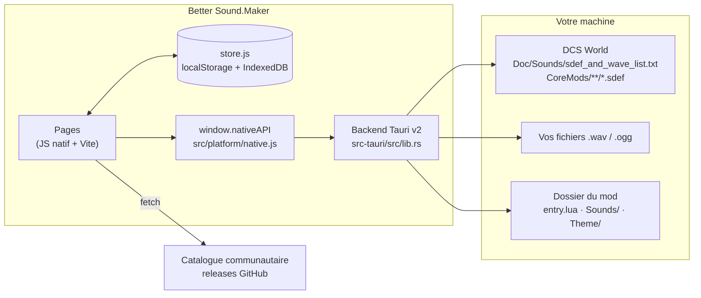

# Fonctionnement

Cette section explique comment Better Sound.Maker (BSM) est construit : ce qui s'exécute où, comment
les données passent de l'installation DCS à un dossier de mod terminé, et pourquoi le code a cette forme.

**À qui elle s'adresse :** contributeurs, mainteneurs d'un fork, mainteneurs du catalogue, et moddeurs
curieux qui veulent savoir exactement ce que l'application écrit sur le disque. Si vous voulez
seulement *créer* un mod, le [guide pas à pas](../guide/index.md) et les
[pages de fonctionnalités](../features/library.md) sont un meilleur point de départ.

---

## Vue d'ensemble

Le frontend fait presque tout le travail : lecture des fichiers SDEF, linter, génération de
`entry.lua`, choix de l'arborescence de sortie. Le backend Rust est volontairement mince : il lit et
écrit des fichiers, ouvre des boîtes de dialogue et dialogue avec la mise à jour BetterInstaller.
C'est pourquoi le même frontend fonctionne aussi comme simple page web (avec moins de possibilités).

## Pages de cette section

| Page | Ce que vous y apprenez |
|---|---|
| [Architecture](architecture.md) | Couches, démarrage, routage, traductions, carte du code |
| [Pont natif](desktop-bridge.md) | Chaque commande Tauri, ses arguments et erreurs, et le repli web |
| [État et stockage](state-and-storage.md) | Le store, ce qui est conservé et où, comment l'audio revient après un redémarrage |
| [Modèle SDEF](sdef-model.md) | Lecture, génération et vérification des SDEF ; la courbe d'atténuation |
| [Construction du mod](mod-build.md) | Les trois stratégies de construction et l'arborescence produite |
| [Chargement du catalogue](catalog-loading.md) | D'où viennent les presets et types de sons communautaires, et dans quel ordre |
| [Mises à jour et versions](updates-and-releases.md) | La chaîne de mise à jour, les clés de signature et la publication |
| [Sécurité](security.md) | Ce qui est protégé, comment, et les limites connues |

Les tableaux de référence sont dans la section **Référence** : [paramètres SDEF](../reference/sdef-parameters.md),
[format du catalogue](../reference/catalog-format.md), [Load.cfg](../reference/load-cfg.md),
[publication](../reference/release.md) et [dépannage](../reference/troubleshooting.md).
