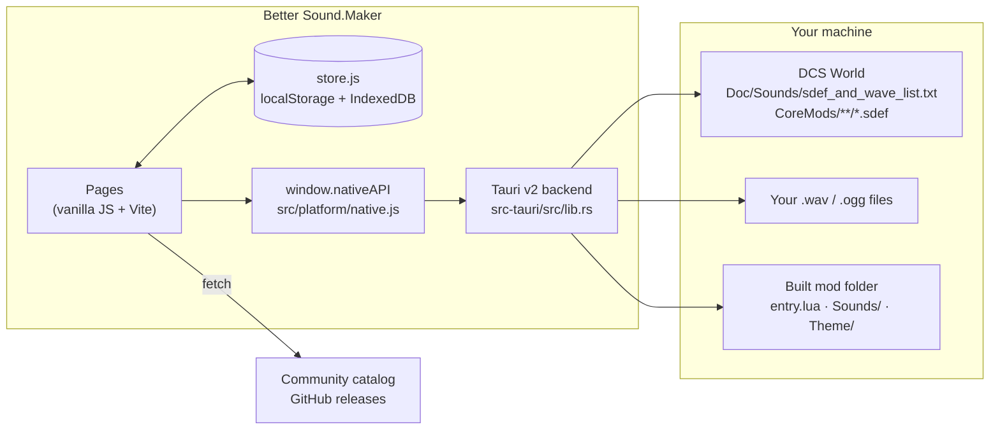

# How it works

This section explains how Better Sound.Maker (BSM) is built: what runs where, how data moves from
the DCS install to a finished mod folder, and why the code is shaped the way it is.

**Who it is for:** contributors, people who maintain a fork, catalog maintainers, and curious modders
who want to know exactly what the app writes to disk. If you only want to *make* a mod, the
[step-by-step guide](../guide/index.md) and the [feature pages](../features/library.md) are a better start.

---

## The system at a glance

The frontend does almost all the work: parsing SDEF files, linting, generating `entry.lua`, deciding
the output layout. The Rust backend is deliberately thin: it reads and writes files, opens dialogs,
and talks to the BetterInstaller updater. That is why the same frontend also runs as a plain web page
(with fewer capabilities).

## Pages in this section

| Page | What you learn |
|---|---|
| [Architecture](architecture.md) | Layers, boot sequence, routing, translations, a map of the codebase |
| [Desktop bridge](desktop-bridge.md) | Every Tauri command, its arguments and errors, and the web fallback |
| [State and storage](state-and-storage.md) | The store, what is persisted where, how audio comes back after a restart |
| [SDEF model](sdef-model.md) | How SDEF files are parsed, generated and linted; the attenuation curve |
| [Mod build](mod-build.md) | The three build strategies and the exact folder layout produced |
| [Catalog loading](catalog-loading.md) | Where community presets and sound types come from, and in which order |
| [Updates and releases](updates-and-releases.md) | The update chain, signing keys and the release pipeline |
| [Security](security.md) | What is protected, how, and the known limitations |

Lookup tables live in the **Reference** section: [SDEF parameters](../reference/sdef-parameters.md),
[catalog format](../reference/catalog-format.md), [Load.cfg](../reference/load-cfg.md),
[release checklist](../reference/release.md) and [troubleshooting](../reference/troubleshooting.md).
