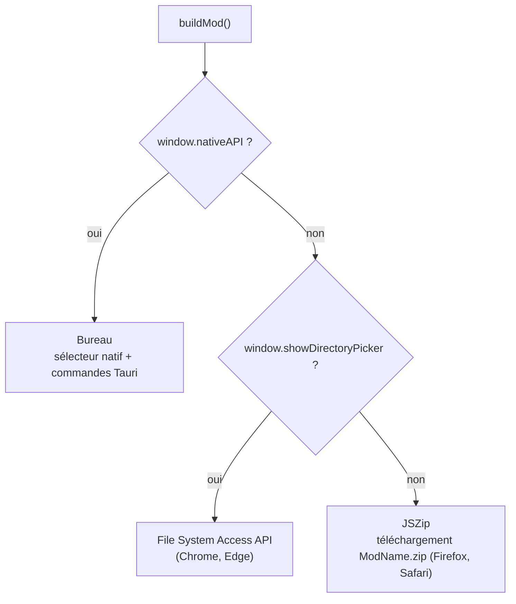

# Construction du mod

La construction transforme votre projet (SDEF sélectionnés, fichiers audio, informations du projet,
thème facultatif) en un dossier de mod que DCS charge. Le code se trouve dans
[`src/utils/mod-builder.js`](https://github.com/FreeProject089/Better-Sound.Maker/blob/main/src/utils/mod-builder.js)
et [`src/utils/entry-generator.js`](https://github.com/FreeProject089/Better-Sound.Maker/blob/main/src/utils/entry-generator.js).
Le côté utilisateur est décrit dans [Construction](../features/build.md).

---

## Trois stratégies

`buildMod(onProgress, { audioFormat })` choisit une stratégie, décidée une fois au chargement du module :



| Stratégie | Comment elle écrit | Remarques |
|---|---|---|
| Bureau | `selectDirectory`, `mkdir`, `writeFile`, `writeBuffer` | aucune restriction du navigateur ; l'audio est envoyé en octets bruts |
| File System Access API | `showDirectoryPicker({ mode: 'readwrite' })`, puis `getDirectoryHandle` / `createWritable` | le navigateur demande l'autorisation sur le dossier choisi |
| Zip | construit l'arborescence en mémoire avec JSZip, puis déclenche un téléchargement | tout reste en RAM jusqu'à la génération du zip |

Les trois produisent la même arborescence. Fermer le sélecteur lève une `AbortError`, signalée comme
`Export cancelled by user` et non comme un échec.

## Arborescence produite

Le nom du dossier est `projectConfig.modName` sans espaces (`SoundMod` s'il est vide).

```text
ModName/
├── entry.lua
├── Sounds/
│   ├── sdef/
│   │   └── Effects/
│   │       └── Aircrafts/FA-18/....sdef
│   └── Effects/
│       └── Aircrafts/FA-18/....wav | .ogg
└── Theme/                         (seulement si le thème est activé)
    ├── icon.png
    └── ME/
        ├── MainMenulogo.png
        ├── loading-window.png
        ├── briefing-map-default.png
        └── base-menu-window.png
```

!!! note "Pourquoi `sdef/Effects/`"
    Le commentaire de `mod-builder.js` garde la trace d'une leçon apprise : DCS ne branche que les SDEF
    placés dans un sous-dossier `Effects/` de `Sounds/sdef/`. Un `Sounds/sdef/Nom.sdef` à plat est vu
    par le gestionnaire de mods mais n'atteint jamais le moteur son.

Pour chaque asset sélectionné :

1. **SDEF** : écrit dans `Sounds/sdef/Effects/<sdefPath>`. Le contenu est le `sdefContent` modifié de l'asset ; s'il n'y en a pas mais que l'asset a des waves personnalisées, un fichier est généré par `generateSdef` à partir des valeurs par défaut du type de son (`detectSoundType` + `getTypeDefaults`).
2. **Audio** : pour chaque chemin de wave de l'asset (waves personnalisées, sinon celles de l'asset d'origine), le fichier propre à la wave s'il existe, sinon le fichier audio principal de l'asset. Un premier segment `Effects/` est retiré, l'extension remplacée par celle de sortie, et le fichier écrit sous `Sounds/Effects/`. Les waves sans aucun audio sont ignorées.

## Conversion audio

La page de construction propose `original`, `wav` ou `ogg`.

| Choix | Ce qui se passe |
|---|---|
| `original` | octets copiés tels quels, extension d'origine conservée |
| `wav` | les fichiers non WAV sont décodés par la Web Audio API (`decodeAudioData`) puis réencodés en **WAV PCM 16 bits** par `audioBufferToWav` ; si le décodage échoue, le fichier d'origine est utilisé |
| `ogg` | décodé par `decodeAudioData`, puis encodé en **Ogg Vorbis** (qualité 0,5, VBR) par la commande Tauri `encode_ogg` (Rust, libvorbis via `vorbis_rs`) ; au-delà de 2 canaux, le son est replié en stéréo |

L'extension de sortie vient toujours du nom du fichier converti (`extOf(converted.name)`) : un
fichier n'est jamais nommé `.ogg` s'il n'est pas réellement en Ogg Vorbis.

!!! note "OGG dans le navigateur"
    Le navigateur n'a pas d'encodeur Vorbis. Dans la version web, choisir `ogg` écrit des fichiers
    **WAV** (nommés `.wav`) et affiche un avertissement dans la console. Si l'encodeur natif échoue,
    l'application de bureau fait de même.

L'encodeur WAV conserve la fréquence d'échantillonnage et le nombre de canaux de la source ; DCS
accepte 1 à 2 canaux dans n'importe quel format PCM (`example.sdef`).

## entry.lua

`generateEntryLua(config)` écrit un bloc `declare_plugin(...)` :

- `developer`, `description`, `version`, et `fileRepoUrl` facultatif depuis les informations du projet ;
- `displayName` (par défaut le nom du mod) et `shortName` (par défaut les 4 premières lettres du nom, en majuscules) ;
- `type = "Tech"` ;
- `mount_vfs_sound_path(current_mod_path .. "/Sounds")`, qui permet à DCS de voir les sons.

Les guillemets doubles des champs utilisateur sont échappés (`\"`) pour qu'un nom ne casse pas la chaîne Lua.

## Theme / ME

Quand `themeEnabled` est actif :

- `entry.lua` déclare une entrée `Skins` `{ name = <modName>, dir = "Theme" }` et appelle `mount_vfs_texture_path(current_mod_path .. "/Theme/ME")` ;
- les images du thème sont écrites : `icon.png` dans `Theme/`, les quatre images de l'éditeur de mission dans `Theme/ME/`.

Quand il est désactivé, ces lignes sont tout de même présentes mais commentées : vous pouvez les
activer à la main. Voir [Thème](../features/theme.md).
