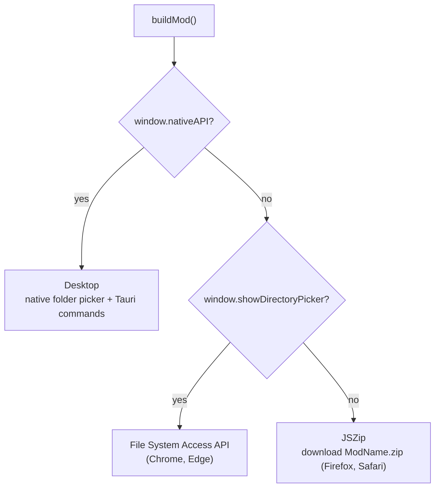

# Mod build

Building turns your project (selected SDEFs, audio files, project info, optional theme) into a mod
folder that DCS loads. The code is
[`src/utils/mod-builder.js`](https://github.com/FreeProject089/Better-Sound.Maker/blob/main/src/utils/mod-builder.js)
and [`src/utils/entry-generator.js`](https://github.com/FreeProject089/Better-Sound.Maker/blob/main/src/utils/entry-generator.js).
The user side is in [Build](../features/build.md).

---

## Three strategies

`buildMod(onProgress, { audioFormat })` picks one strategy, decided once when the module is loaded:



| Strategy | How it writes | Notes |
|---|---|---|
| Desktop | `selectDirectory`, `mkdir`, `writeFile`, `writeBuffer` | no browser restrictions; audio is sent as raw bytes |
| File System Access API | `showDirectoryPicker({ mode: 'readwrite' })`, then `getDirectoryHandle` / `createWritable` | the browser asks for permission on the chosen folder |
| Zip | builds the tree in memory with JSZip, then triggers a download | everything is held in RAM until the zip is generated |

All three produce the same tree. Cancelling the picker raises an `AbortError`, which is reported as
`Export cancelled by user` instead of a failure.

## Output layout

The mod folder name is `projectConfig.modName` with spaces removed (`SoundMod` if empty).

```text
ModName/
├── entry.lua
├── Sounds/
│   ├── sdef/
│   │   └── Effects/
│   │       └── Aircrafts/FA-18/....sdef
│   └── Effects/
│       └── Aircrafts/FA-18/....wav | .ogg
└── Theme/                         (only if the theme is enabled)
    ├── icon.png
    └── ME/
        ├── MainMenulogo.png
        ├── loading-window.png
        ├── briefing-map-default.png
        └── base-menu-window.png
```

!!! note "Why `sdef/Effects/`"
    The comment in `mod-builder.js` records a lesson learned: DCS only wires SDEF files nested
    under an `Effects/` sub-folder of `Sounds/sdef/`. A flat `Sounds/sdef/Name.sdef` is seen by the
    mod manager but never reaches the sound engine.

For each selected asset:

1. **SDEF**: written to `Sounds/sdef/Effects/<sdefPath>`. The content is the asset's edited `sdefContent`; if there is none but the asset has custom waves, a file is generated with `generateSdef` from the sound type's defaults (`detectSoundType` + `getTypeDefaults`).
2. **Audio**: for each wave path of the asset (custom waves, else the original asset's waves), the per-wave file if one was assigned, else the asset's main audio file. A leading `Effects/` segment is removed, the extension replaced with the output one, and the file written under `Sounds/Effects/`. Waves with no audio at all are skipped.

## Audio conversion

The build page offers `original`, `wav` or `ogg`.

| Choice | What happens |
|---|---|
| `original` | bytes copied unchanged, original extension kept |
| `wav` | non-WAV files are decoded with the Web Audio API (`decodeAudioData`) and re-encoded as **16-bit PCM WAV** by `audioBufferToWav`; if decoding fails, the original file is used |
| `ogg` | decoded with `decodeAudioData`, then encoded to **Ogg Vorbis** (quality 0.5, VBR) by the `encode_ogg` Tauri command (Rust, libvorbis via `vorbis_rs`); more than 2 channels are folded into stereo |

The output extension always comes from the converted file's own name (`extOf(converted.name)`), so
a file is never named `.ogg` unless it really is Ogg Vorbis.

!!! note "OGG in the browser"
    The browser has no Vorbis encoder. In the web build, choosing `ogg` writes **WAV** files (named
    `.wav`) and logs a console warning. If the native encoder fails, the desktop app does the same.

The WAV encoder keeps the source sample rate and channel count; DCS accepts 1–2 channels in any PCM
format (`example.sdef`).

## entry.lua

`generateEntryLua(config)` writes a `declare_plugin(...)` block:

- `developer`, `description`, `version`, optional `fileRepoUrl` from the project info;
- `displayName` (defaults to the mod name) and `shortName` (defaults to the first 4 letters of the mod name, upper-cased);
- `type = "Tech"`;
- `mount_vfs_sound_path(current_mod_path .. "/Sounds")`, which is what makes DCS see the sounds.

Double quotes in user fields are escaped (`\"`) so a name cannot break the Lua string.

## Theme / ME

When `themeEnabled` is on:

- `entry.lua` declares a `Skins` entry `{ name = <modName>, dir = "Theme" }` and calls `mount_vfs_texture_path(current_mod_path .. "/Theme/ME")`;
- the theme images are written: `icon.png` in `Theme/`, the four mission-editor images in `Theme/ME/`.

When it is off, those lines are still present but commented out, so you can enable them by hand.
See [Theme](../features/theme.md).
