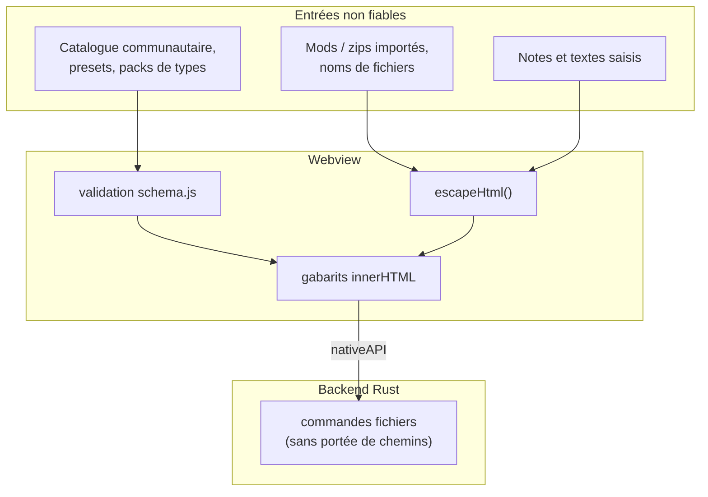

# Sécurité

Better Sound.Maker lit votre installation DCS, écrit des dossiers de mods et récupère du contenu
communautaire sur Internet. Cette page liste les protections présentes dans le code et, tout aussi
franchement, celles qui n'existent pas encore.

---

## Frontières de confiance

## Échappement HTML

L'interface est construite avec des chaînes gabarits affectées à `innerHTML`. Toute valeur qui ne
vient pas des gabarits de l'application pourrait injecter du balisage ou du script (CWE-79). L'outil
est [`src/utils/html.js`](https://github.com/FreeProject089/Better-Sound.Maker/blob/main/src/utils/html.js) :
`escapeHtml()` remplace `& < > " '` par des entités.

Il est importé dans `components/toast.js` et dans les pages `build`, `collaboration`, `library`,
`presets`, `project`, `sdef-editor` et `settings`, là où s'affichent notes, noms de fichiers et de
dossiers, champs de presets et données de mods importés. `update-check.js` a son propre `escapeText()`
pour les numéros de version et notes de version qu'il affiche.

!!! warning "Pas partout"
    L'échappement est appliqué à chaque endroit d'appel, pas imposé globalement. Du code qui insère des
    données externes sans appeler `escapeHtml` est un bug : signalez-le.

## Validation du catalogue

Tout ce qui vient du catalogue communautaire passe par `src/catalog/schema.js` avant usage (voir
[Chargement du catalogue](catalog-loading.md#validation)) : URL limitées à `http`, `https` et `file`,
identifiants et types vérifiés, expressions régulières compilées dans un `try`, entrées invalides
écartées. Les règles de types de sons ne servent que d'expressions régulières ; rien du catalogue
n'est exécuté comme du code.

## Portée du système de fichiers {#file-system-scope}

Les commandes de l'application (`write_file`, `write_buffer`, `mkdir`, `read_file`, `read_text_file`,
`read_dir`, `exists`, `scan_sdefs`, `open_path`) acceptent **n'importe quel chemin absolu**. Il n'y a
ni liste de dossiers autorisés ni contrôle de `..` dans `lib.rs`.

!!! danger "Limite connue"
    Tout script exécuté dans la webview peut lire ou écrire n'importe quel fichier accessible à votre
    utilisateur Windows. Le risque est limité parce que la webview ne charge que le bundle de
    l'application et que les données externes sont échappées, mais une seule faille XSS aurait un accès
    complet aux fichiers. Restreindre ces commandes aux dossiers DCS, Saved Games et d'export choisis
    serait un durcissement judicieux ; ce n'est pas le comportement actuel.

`open_path` confie un chemin au gestionnaire par défaut du système. Dans l'application, il ne sert
qu'aux *Paramètres* pour ouvrir le dossier DCS saisi dans le champ correspondant.

## Content Security Policy

`tauri.conf.json` définit `app.security.csp` à **`null`** : aucune CSP n'est appliquée. Avec les
commandes fichiers non restreintes, cela fait de l'échappement HTML la principale défense actuelle
contre l'injection de script. Définir une CSP stricte serait un autre durcissement judicieux.

## Mises à jour signées

Les deux canaux de mise à jour vérifient les signatures avant d'installer (voir [Mises à jour et versions](updates-and-releases.md)) :

- **BetterInstaller** : `bsm.bpkg` et `update.json` signés en Ed25519, `require_signature = true` ; le manifeste expire après 7 jours, si bien qu'un ancien manifeste ne peut pas être rejoué indéfiniment.
- **Updater Tauri** : paquets NSIS/MSI signés avec minisign ; la clé publique est intégrée à `tauri.conf.json`.

Le troisième recours (vérification de version GitHub) n'installe rien ; il ouvre seulement la page des releases.

## Fichiers générés

`entry.lua` échappe les guillemets doubles des champs texte qu'il écrit (nom du mod, auteur,
description, URL, crédits, noms affiché et court) : un guillemet ne peut pas fermer la chaîne Lua. Les
barres obliques inverses et retours à la ligne ne sont pas échappés, et `version` est écrit tel quel.
Les valeurs SDEF sont écrites telles que saisies ; le linter signale les clés inconnues mais ne
nettoie pas les valeurs.
