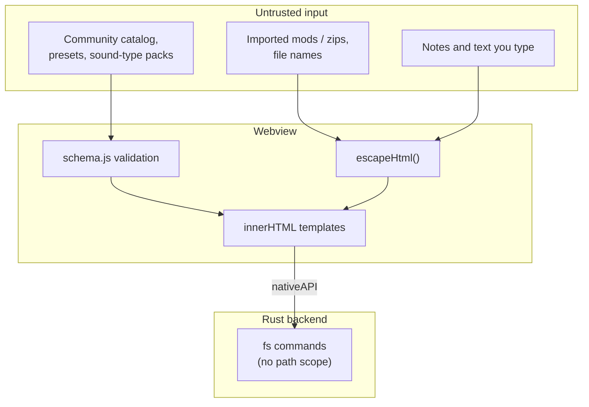

# Security

Better Sound.Maker reads your DCS install, writes mod folders and fetches community content from the
internet. This page lists the protections that exist in the code, and, just as plainly, the ones that
do not exist yet.

---

## Trust boundaries

## HTML escaping

The UI is built with template strings assigned to `innerHTML`. Any value that did not come from the
app's own templates could inject markup or script (CWE-79). The helper is
[`src/utils/html.js`](https://github.com/FreeProject089/Better-Sound.Maker/blob/main/src/utils/html.js):
`escapeHtml()` replaces `& < > " '` with entities.

It is imported in `components/toast.js` and in the pages `build`, `collaboration`, `library`,
`presets`, `project`, `sdef-editor` and `settings`, the places that display notes, file and folder
names, preset fields and imported mod data. `update-check.js` has its own `escapeText()` for the
version numbers and release notes it shows.

!!! warning "Not every page"
    Escaping is applied at each call site, not enforced globally. Code that interpolates external
    data without calling `escapeHtml` is a bug: please report it.

## Catalog validation

Everything fetched from the community catalog goes through `src/catalog/schema.js` before use (see
[Catalog loading](catalog-loading.md#validation)): URLs limited to `http`, `https` and `file`, ids and
types checked, regexes compiled in a `try`, invalid entries dropped. Sound-type rules are used as
regular expressions only; nothing from the catalog is executed as code.

## File system scope

The app's own commands (`write_file`, `write_buffer`, `mkdir`, `read_file`, `read_text_file`,
`read_dir`, `exists`, `scan_sdefs`, `open_path`) accept **any absolute path**. There is no allow-list
of folders and no `..` check in `lib.rs`.

!!! danger "Known limitation"
    Any script running in the webview can read or write any file your Windows user can. The
    risk is limited by the fact that the webview only loads the app's own bundle and that external
    data is escaped, but a single XSS would have full file access. Restricting these commands to the
    chosen DCS, Saved Games and export folders would be a sensible hardening; it is not current behaviour.

`open_path` hands a path to the OS default handler. In the app it is only used by *Settings* to open
the DCS folder typed in the DCS path field.

## Content Security Policy

`tauri.conf.json` sets `app.security.csp` to **`null`**, so no CSP is applied. Combined with the
unrestricted file commands, this means HTML escaping is currently the main defence against injected
script. Setting a strict CSP would be another sensible hardening.

## Signed updates

Both update channels verify signatures before installing (see [Updates and releases](updates-and-releases.md)):

- **BetterInstaller**: `bsm.bpkg` and `update.json` signed with Ed25519, `require_signature = true`; the manifest expires after 7 days, so an old manifest cannot be replayed indefinitely.
- **Tauri updater**: NSIS/MSI packages signed with minisign; the public key is embedded in `tauri.conf.json`.

The third fallback (GitHub version check) installs nothing; it only opens the releases page.

## Generated files

`entry.lua` escapes double quotes in the text fields it writes (mod name, author, description, URL,
credits, display and short name) and the version through `luaString`: backslashes, quotes, newlines,
tabs and other control characters are escaped, so no value can close the Lua string. The header comment
lines get the same values with line breaks flattened, so a newline cannot turn the rest of a line into code. SDEF values are written as typed; the linter flags unknown keys
but does not sanitise values.
