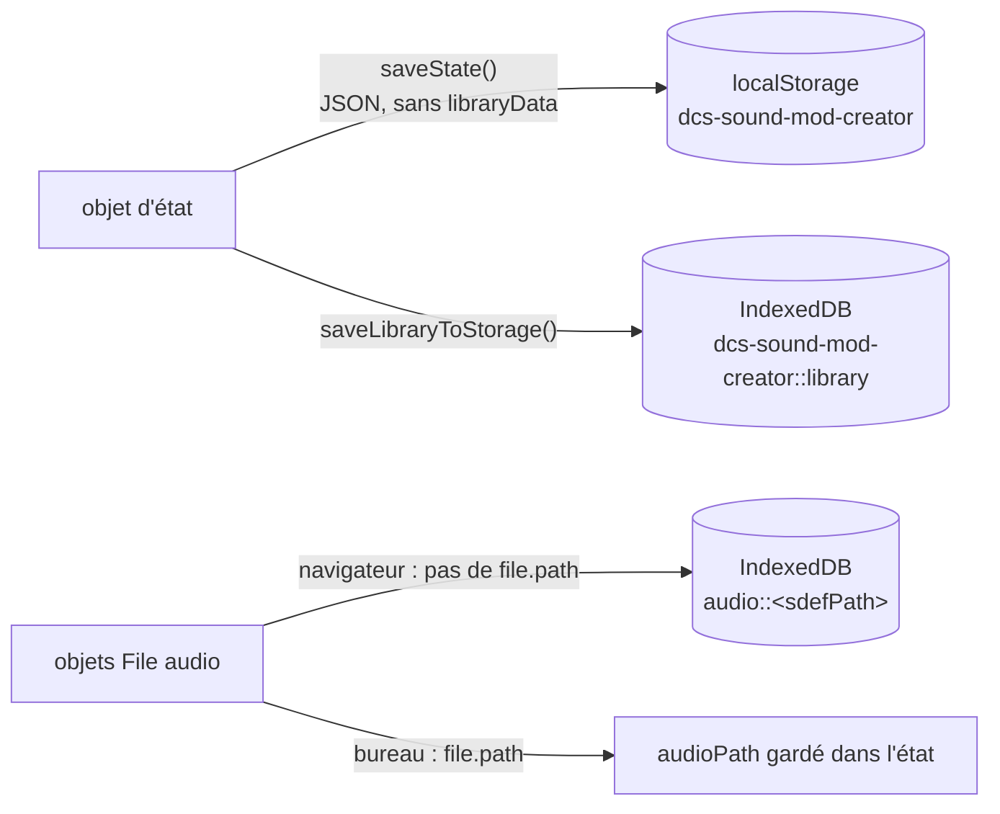

# État et stockage

Tout l'état de l'application vit dans un seul objet, dans
[`src/state/store.js`](https://github.com/FreeProject089/Better-Sound.Maker/blob/main/src/state/store.js).
Pas de store de framework : les pages appellent `getState()`, modifient via des fonctions exportées
et s'abonnent aux clés qui les intéressent.

---

## Forme de l'état

| Clé | Contenu | Sauvegardé |
|---|---|---|
| `selectedAssets` | `sdefPath → { sdefContent, audioFileName, audioMeta, audioPath, customWaves, waveAudioFiles, note… }` | oui |
| `assetNotes` | `sdefPath` ou `wave::<chemin>` → texte | oui |
| `projectConfig` | `modName`, `author`, `version`, `description`, `url`, `credits`, `displayName`, `shortName`, `themeEnabled` | oui |
| `themeImages` | emplacement → `{ fileName, dataUrl }` | oui |
| `presets` | presets enregistrés | oui |
| `currentPage` | clé du routeur (`library` par défaut) | oui |
| `currentSdef` | SDEF ouvert dans l'éditeur | oui |
| `libraryData` | sections de la bibliothèque | **non** dans localStorage (dans IndexedDB, voir plus bas) |
| `globalSettings` | `dcsPath`, `savedGamesPath`, `autoScan`, et d'autres comme `catalogUrl` | oui |
| `unsavedSdefs` | brouillons de l'éditeur | oui |
| `sdefTemplates` | `{ id, name, lucideIcon, params }` | oui |

Les vrais objets `File` / `Blob` de l'audio et des images du thème ne sont **pas** dans l'état : ils
vivent dans deux `Map` du module (`audioFiles`, `themeFiles`), car un fichier ne se sérialise pas en JSON.

## Abonnement / notification

```js
const unsubscribe = subscribe('selectedAssets', (value) => { … });
```

`setState(clé, valeur)` affecte la clé, appelle `notify(clé)` puis `saveState()`. `notify` exécute
chaque écouteur de la clé, puis chaque écouteur inscrit sur `'*'` avec l'état complet. `subscribe`
renvoie une fonction de désabonnement. Les fonctions comme `selectAsset`, `setAudioFile` ou
`updateProjectConfig` suivent le même schéma : modifier, notifier, sauvegarder.

## Où les données sont stockées



| Stockage | Clé | Contenu |
|---|---|---|
| localStorage | `dcs-sound-mod-creator` | l'état en JSON |
| localStorage | `dcs-sound-mod-creator::language` | langue de l'interface |
| localStorage | `bsm-last-run-version` | dernière version ayant affiché ses notes |
| localStorage | `bsm-community-catalog-cache` | dernier catalogue communautaire valide (voir [Chargement du catalogue](catalog-loading.md)) |
| localStorage | `bsm-custom-types` | types de sons de l'utilisateur |
| IndexedDB (`idb-keyval`) | `dcs-sound-mod-creator::library` | bibliothèque analysée (trop grosse pour localStorage) |
| IndexedDB | `audio::<sdefPath>` et `audio::<sdefPath>::<wavePath>` | blobs audio quand il n'y a pas de chemin disque |

**Pourquoi deux stockages.** localStorage est synchrone et simple, mais limité à quelques mégaoctets
de texte. La bibliothèque DCS analysée et les blobs audio sont bien plus gros : ils vont dans IndexedDB
via [`idb-keyval`](https://github.com/jakearchibald/idb-keyval), qui stocke directement des `Blob`.

## Restauration de l'audio au redémarrage

À son import, `store.js` appelle `loadState()` puis la fonction asynchrone `restoreAudioFiles()` :

1. **Bureau** : pour chaque asset sélectionné (et chaque fichier par wave) qui a un `audioPath`, lit le fichier avec `nativeAPI.readFile`, l'enveloppe dans un `Blob` (`audio/ogg` si le nom finit par `.ogg`, sinon `audio/wav`) et lui rattache `name` et `path`. Rien n'est copié : l'application retient seulement où se trouvait votre fichier.
2. **IndexedDB** : pour chaque clé `audio::` pas encore restaurée, charge le blob.

Chaque étape appelle `notify('selectedAssets')` si elle a restauré quelque chose, pour rafraîchir les pages ouvertes.

!!! warning "Déplacer ou supprimer vos fichiers audio"
    Sur bureau, si vous déplacez ou supprimez le fichier audio d'origine, `readFile` renvoie `null` et
    l'asset perd son audio sans prévenir. Réassignez le fichier dans la Bibliothèque.
