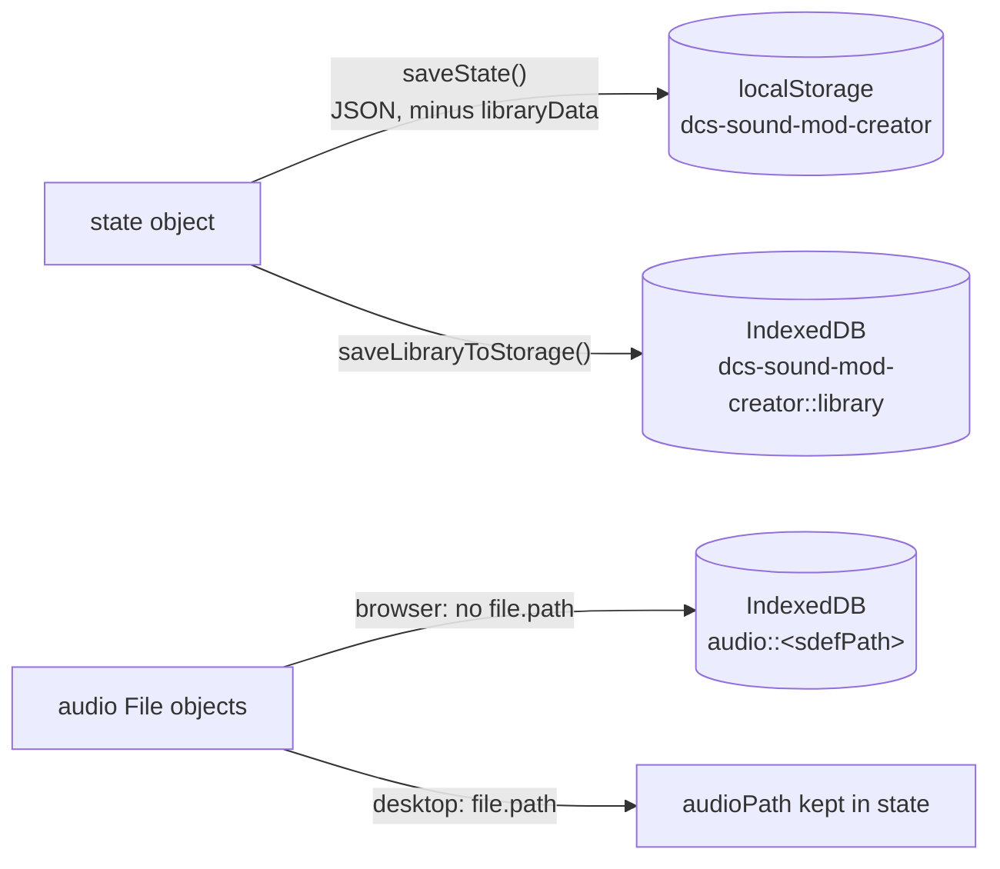

# State and storage

All application state lives in one plain object inside
[`src/state/store.js`](https://github.com/FreeProject089/Better-Sound.Maker/blob/main/src/state/store.js).
There is no framework store: pages call `getState()`, mutate through exported helpers, and subscribe
to the keys they care about.

---

## State shape

| Key | Content | Persisted |
|---|---|---|
| `selectedAssets` | `sdefPath → { sdefContent, audioFileName, audioMeta, audioPath, customWaves, waveAudioFiles, note… }` | yes |
| `assetNotes` | `sdefPath` or `wave::<path>` → text | yes |
| `projectConfig` | `modName`, `author`, `version`, `description`, `url`, `credits`, `displayName`, `shortName`, `themeEnabled` | yes |
| `themeImages` | slot → `{ fileName, dataUrl }` | yes |
| `presets` | saved presets | yes |
| `currentPage` | router key (default `library`) | yes |
| `currentSdef` | SDEF open in the editor | yes |
| `libraryData` | parsed library sections | **no** in localStorage (stored in IndexedDB instead, see below) |
| `globalSettings` | `dcsPath`, `savedGamesPath`, `autoScan`, and others such as `catalogUrl` | yes |
| `unsavedSdefs` | editor drafts | yes |
| `sdefTemplates` | `{ id, name, lucideIcon, params }` | yes |

The actual `File` / `Blob` objects for audio and theme images are **not** in the state: they live in
two module-level `Map`s (`audioFiles`, `themeFiles`), because files cannot be serialised to JSON.

## Subscribe / notify

```js
const unsubscribe = subscribe('selectedAssets', (value) => { … });
```

`setState(key, value)` assigns the key, calls `notify(key)`, then `saveState()`. `notify` runs every
listener for that key, then every listener registered on `'*'` with the whole state. `subscribe`
returns an unsubscribe function. Helpers such as `selectAsset`, `setAudioFile` or
`updateProjectConfig` follow the same pattern: mutate, notify, save.

## Where data is stored



| Store | Key | What |
|---|---|---|
| localStorage | `dcs-sound-mod-creator` | the state JSON |
| localStorage | `dcs-sound-mod-creator::language` | UI language |
| localStorage | `bsm-last-run-version` | last version that showed release notes |
| localStorage | `bsm-community-catalog-cache` | last good community catalog (see [Catalog loading](catalog-loading.md)) |
| localStorage | `bsm-custom-types` | user sound types |
| IndexedDB (`idb-keyval`) | `dcs-sound-mod-creator::library` | parsed library (too big for localStorage) |
| IndexedDB | `audio::<sdefPath>` and `audio::<sdefPath>::<wavePath>` | audio blobs when there is no disk path |

**Why two stores.** localStorage is synchronous and simple but limited to a few megabytes of strings.
The parsed DCS library and audio blobs are far larger, so they go to IndexedDB through
[`idb-keyval`](https://github.com/jakearchibald/idb-keyval), which stores `Blob`s directly.

## Audio restore after a restart

When `store.js` is imported it calls `loadState()` and then an async `restoreAudioFiles()`:

1. **Desktop**: for each selected asset (and each per-wave file) that has an `audioPath`, read the file with `nativeAPI.readFile`, wrap it in a `Blob` (`audio/ogg` if the name ends in `.ogg`, otherwise `audio/wav`), and re-attach `name` and `path`. Nothing is copied: the app only remembers where your file was.
2. **IndexedDB**: for every `audio::` key not already restored, load the blob.

Each step calls `notify('selectedAssets')` when it restored something, so open pages refresh.

!!! warning "Moving or deleting your audio files"
    On desktop, if you move or delete the original audio file, `readFile` returns `null` and the
    asset silently loses its audio. Re-assign the file in the Library.
