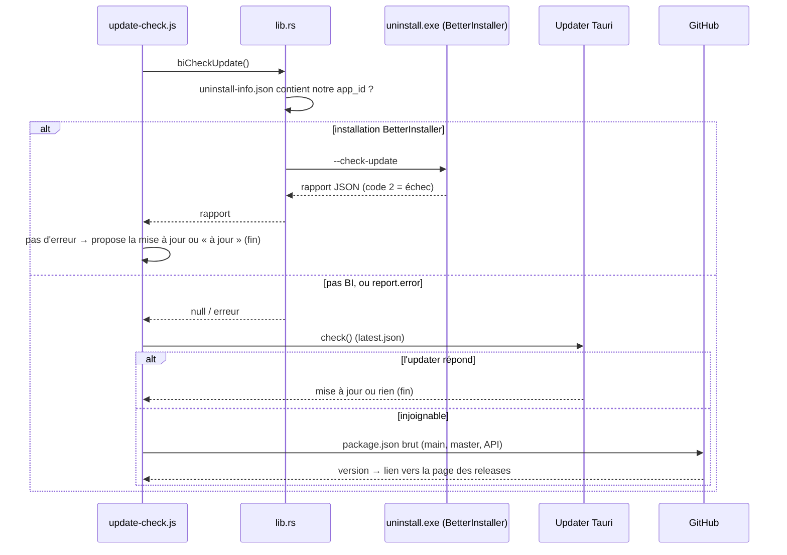

# Mises à jour et versions

Better Sound.Maker peut être installé de trois façons : avec **BetterInstaller** (l'installeur
principal), ou avec les installeurs **NSIS** ou **MSI** de Tauri (gardés en secours). Chacun a son
propre canal de mise à jour, et l'application doit trouver le bon à l'exécution. Côté utilisateur,
voir [Mettre à jour l'application](../guide/update-the-app.md).

---

## La chaîne de mise à jour

`checkUpdate(quiet)` dans
[`src/utils/update-check.js`](https://github.com/FreeProject089/Better-Sound.Maker/blob/main/src/utils/update-check.js)
essaie trois mécanismes dans l'ordre. Chacun répond « traité » ou « pas pour moi / échec », et seul
le second cas passe au suivant.



| Étape | S'applique à | Installe avec |
|---|---|---|
| 1. BetterInstaller | copies installées par BetterInstaller | `uninstall.exe --update` : `.bpkg` signé, retour arrière, relance |
| 2. Updater Tauri | installations NSIS/MSI, et installations BI dont la vérification a échoué | `update.downloadAndInstall()` puis `relaunch()` |
| 3. Vérification GitHub | tout le reste (et la version web) | rien : ouvre la page des releases |

La vérification automatique a lieu 1,5 s après le démarrage (en silence), sauf si
`DisableAutoUpdate = true` dans [`Load.cfg`](../reference/load-cfg.md). Si l'application d'une mise à
jour BetterInstaller ne démarre pas, le code se rabat sur l'updater Tauri, puis sur la page des releases.

## Détecter une installation BetterInstaller

`better_installer_exe()` dans [`lib.rs`](https://github.com/FreeProject089/Better-Sound.Maker/blob/main/src-tauri/src/lib.rs)
cherche `uninstall-info.json` à côté de l'exécutable et exige que son `app_id` vaille
`com.bettersoundmaker.app`. Ce n'est qu'alors qu'il renvoie le `uninstall.exe` voisin.

!!! note "Pourquoi ne pas simplement chercher uninstall.exe ?"
    L'installeur NSIS de Tauri laisse lui aussi un `uninstall.exe` à côté de l'application. Le lancer
    avec `--check-update` serait une erreur. BetterInstaller écrit `uninstall-info.json` avec
    l'identifiant de l'application ; NSIS ne le fait jamais. Ce fichier est la preuve.

### `bi_check_update`

Lance `uninstall.exe --check-update` sur un thread bloquant, avec `CREATE_NO_WINDOW` sous Windows pour
qu'aucune console n'apparaisse. Renvoie :

- `null` si ce n'est pas une installation BetterInstaller (le frontend passe à l'updater Tauri) ;
- le rapport JSON analysé (`update_available`, `current_version`, `latest_version`, `notes`…) ;
- si la sortie n'est pas du JSON, `{ "update_available": false }` ;
- si le code de sortie vaut 2 et que le rapport n'a pas d'`error`, `error` reçoit `BetterInstaller check failed`.

### `bi_apply_update`

Lance `uninstall.exe --update --wait-pid <notre pid> --launch`, puis ferme l'application.
BetterInstaller attend la fin du processus, applique la mise à jour signée avec retour arrière
possible, et relance l'application.

## Fichiers d'une version

[`scripts/release.ps1`](https://github.com/FreeProject089/Better-Sound.Maker/blob/main/scripts/release.ps1)
produit tout dans `./release` :

| Fichier | Produit par | Utilisé par |
|---|---|---|
| `Better.Sound.Maker.Setup.<v>.exe` | `bpkg build` | utilisateurs (installeur principal) |
| `bsm.bpkg` | `bpkg pack` + `bpkg sign` | mises à jour BetterInstaller |
| `update.json` | `bpkg update-manifest` (vérifié par `verify-manifest`) | `--check-update` de BetterInstaller |
| `Better.Sound.Maker_<v>_x64-nsis-setup.exe` + `.sig` | `tauri build` | utilisateurs (secours) et updater Tauri |
| `Better.Sound.Maker_<v>_x64.msi` + `.sig` | `tauri build` | utilisateurs (secours) et updater Tauri |
| `latest.json` | écrit par le script | updater Tauri (entrées `windows-x86_64`, `-nsis`, `-msi`) |

Étapes : recopier la version de `package.json` dans `installer/installer.toml` et
`src-tauri/Cargo.toml` (`tauri.conf.json` lit directement `../package.json`), lancer `tauri build`,
copier les fichiers NSIS/MSI et écrire `latest.json`, assembler la charge utile BetterInstaller (exe,
`LICENSE`, `Update`, `public`, logo), empaqueter et signer `bsm.bpkg`, construire l'installeur, écrire
et vérifier `update.json`. Les versions sont étiquetées **sans** préfixe `v`. La liste pas à pas est
dans [Publication](../reference/release.md).

## installer/installer.toml

[`installer/installer.toml`](https://github.com/FreeProject089/Better-Sound.Maker/blob/main/installer/installer.toml)
configure BetterInstaller : identifiant de l'application (le même que celui de Tauri), installation
dans `%LOCALAPPDATA%\Programs\<nom>` sans UAC, raccourcis, mode portable autorisé, **clé publique**
Ed25519 avec `require_signature = true`, et l'URL du manifeste `…/releases/latest/download/update.json`
avec `allow_delta = true`.

## Clés de signature

Deux signatures indépendantes, deux clés. **Aucune clé privée n'est dans le dépôt.**

| Clé | Emplacement par défaut | Variable de remplacement | Signe |
|---|---|---|---|
| Updater Tauri (minisign) | `~/.tauri/better-sound-maker.key` | `TAURI_SIGNING_PRIVATE_KEY` (+ `_PASSWORD`) | les `.sig` NSIS/MSI ; clé publique dans `tauri.conf.json > plugins.updater.pubkey` |
| BetterInstaller (Ed25519) | `~/.betterinstaller/better-sound-maker/private.key` (+ `public.key`) | `BSM_BI_PRIVATE_KEY_FILE` | `bsm.bpkg` et `update.json` ; clé publique dans `installer.toml` |

!!! danger "Sauvegardez les deux clés privées"
    Perdre une clé signifie que les copies installées ne pourront plus jamais vérifier une mise à
    jour : les utilisateurs devraient réinstaller à la main.

## update.json expire après 7 jours

BetterInstaller refuse un manifeste non signé, étranger ou **expiré**, et `update.json` est signé pour
7 jours au plus. Entre deux versions, il faut le renouveler :

```bash
bpkg resign-manifest update.json --key ~/.betterinstaller/better-sound-maker/private.key
```

puis le téléverser à nouveau sur la dernière release. S'il expire, `--check-update` signale une
erreur ; BSM se rabat alors sur l'updater Tauri (étape 2) : les utilisateurs ne sont pas bloqués, mais
perdent le retour arrière de BetterInstaller. Contexte : `docs/UPDATER-SETUP.md` de BetterInstaller.
