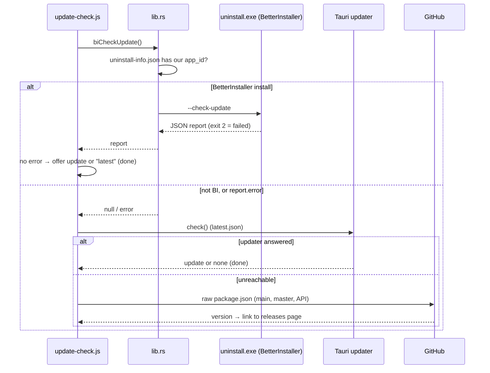

# Updates and releases

Better Sound.Maker can be installed three ways: with **BetterInstaller** (the primary installer),
or with Tauri's **NSIS** or **MSI** installers (kept as backups). Each has its own update channel,
and the app has to find the right one at runtime. For the user side, see
[Update the app](../guide/update-the-app.md).

---

## The update chain

[`src/utils/update-check.js`](https://github.com/FreeProject089/Better-Sound.Maker/blob/main/src/utils/update-check.js)
`checkUpdate(quiet)` tries three mechanisms in order. Each one answers "handled" or "not my job / failed",
and only the second case falls through.



| Step | Applies to | Installs with |
|---|---|---|
| 1. BetterInstaller | copies installed by BetterInstaller | `uninstall.exe --update`: signed `.bpkg`, rollback, relaunch |
| 2. Tauri updater | NSIS/MSI installs, and BI installs whose check failed | `update.downloadAndInstall()` then `relaunch()` |
| 3. GitHub check | anything else (and the web build) | nothing: opens the releases page |

The automatic check runs 1.5 s after start (quietly) unless `DisableAutoUpdate = true` in
[`Load.cfg`](../reference/load-cfg.md). If applying a BetterInstaller update fails to start, the
code falls back to the Tauri updater, then to the releases page.

## Detecting a BetterInstaller install

`better_installer_exe()` in [`lib.rs`](https://github.com/FreeProject089/Better-Sound.Maker/blob/main/src-tauri/src/lib.rs)
looks next to the running executable for `uninstall-info.json` and requires its `app_id` to equal
`com.bettersoundmaker.app`. Only then does it return the `uninstall.exe` beside it.

!!! note "Why not just look for uninstall.exe?"
    Tauri's NSIS installer also leaves an `uninstall.exe` next to the app. Running *that* with
    `--check-update` would be wrong. BetterInstaller writes `uninstall-info.json` with the app id;
    NSIS never does. That file is the proof.

### `bi_check_update`

Runs `uninstall.exe --check-update` on a blocking thread, with `CREATE_NO_WINDOW` on Windows so no
console flashes. It returns:

- `null` when this is not a BetterInstaller install (the frontend moves on to the Tauri updater);
- the parsed JSON report (`update_available`, `current_version`, `latest_version`, `notes`…);
- if stdout is not JSON, `{ "update_available": false }`;
- if the exit code is 2 and the report has no `error`, `error` is set to `BetterInstaller check failed`.

### `bi_apply_update`

Spawns `uninstall.exe --update --wait-pid <our pid> --launch`, then exits the app. BetterInstaller
waits for the process to end, applies the signed update with rollback, and relaunches the app.

## Release assets

[`scripts/release.ps1`](https://github.com/FreeProject089/Better-Sound.Maker/blob/main/scripts/release.ps1)
builds everything into `./release`:

| Asset | Produced by | Used by |
|---|---|---|
| `Better.Sound.Maker.Setup.<v>.exe` | `bpkg build` | users (primary installer) |
| `bsm.bpkg` | `bpkg pack` + `bpkg sign` | BetterInstaller updates |
| `update.json` | `bpkg update-manifest` (verified with `verify-manifest`) | BetterInstaller `--check-update` |
| `Better.Sound.Maker_<v>_x64-nsis-setup.exe` + `.sig` | `tauri build` | users (backup) and the Tauri updater |
| `Better.Sound.Maker_<v>_x64.msi` + `.sig` | `tauri build` | users (backup) and the Tauri updater |
| `latest.json` | written by the script | Tauri updater (`windows-x86_64`, `-nsis`, `-msi` entries) |

Steps: sync the version from `package.json` into `installer/installer.toml` and `src-tauri/Cargo.toml`
(`tauri.conf.json` reads `../package.json` directly), run `tauri build`, copy the NSIS/MSI files and
write `latest.json`, assemble the BetterInstaller payload (exe, `LICENSE`, `Update`, `public`,
logo), pack and sign `bsm.bpkg`, build the setup, write and verify `update.json`. Releases are tagged
**without** a `v` prefix. The step-by-step checklist is in [Release](../reference/release.md).

## installer/installer.toml

[`installer/installer.toml`](https://github.com/FreeProject089/Better-Sound.Maker/blob/main/installer/installer.toml)
configures BetterInstaller: app id (same as Tauri's identifier), install under
`%LOCALAPPDATA%\Programs\<name>` without UAC, shortcuts, portable mode allowed, the Ed25519
**public key** with `require_signature = true`, and the update manifest URL
`…/releases/latest/download/update.json` with `allow_delta = true`.

## Signing keys

Two independent signatures, two keys. **Neither private key is in the repository.**

| Key | Default location | Override | Signs |
|---|---|---|---|
| Tauri updater (minisign) | `~/.tauri/better-sound-maker.key` | `TAURI_SIGNING_PRIVATE_KEY` (+ `_PASSWORD`) | NSIS/MSI `.sig` files; public key in `tauri.conf.json > plugins.updater.pubkey` |
| BetterInstaller (Ed25519) | `~/.betterinstaller/better-sound-maker/private.key` (+ `public.key`) | `BSM_BI_PRIVATE_KEY_FILE` | `bsm.bpkg` and `update.json`; public key in `installer.toml` |

!!! danger "Back up both private keys"
    Losing a key means installed copies can never verify an update again: users would have to
    reinstall by hand.

## update.json expires after 7 days

BetterInstaller refuses an unsigned, foreign or **expired** manifest, and `update.json` is signed for
at most 7 days. Between releases it must be renewed:

```bash
bpkg resign-manifest update.json --key ~/.betterinstaller/better-sound-maker/private.key
```

then re-upload it to the latest release. If it expires, `--check-update` reports an error; BSM then
falls back to the Tauri updater (step 2), so users are not stuck, but they lose BetterInstaller's
rollback. Background: BetterInstaller's `docs/UPDATER-SETUP.md`.
